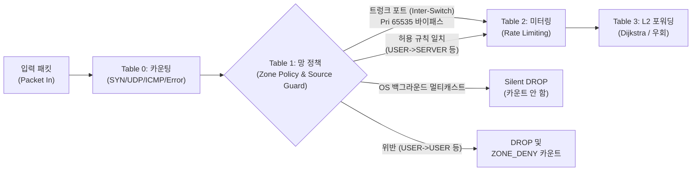

# 🛡️ [상세 실행 계획서] SDN 동적 망 분리 (Dynamic Network Segmentation)

> **문서 상태**: 승인 및 실행 확정 (박시현 검토 완료, 김관우 설계안 반영, 실무 고려사항 7대 안전 대책 보강 완료)  
> **적용 전략**: **옵션 A (현재 4-Switch 다이아몬드 환경 우선 완성 및 검증 후 토폴로지 확장 연계)**  
> **기반 문서**: [김관우 원안 설계안](../archive/planning/network_segmentation_plan.md), [시스템 종합 로드맵](ROADMAP.md#phase-6-b-2)

---

## 1. 개요 및 옵션 A 채택 배경

### 1.1 해결하고자 하는 문제 (배경)
1. **내부 전파 무방비**: 단일 서브넷(`10.0.0.0/24`) 환경에서 모든 호스트가 상호 통신 가능하여 SMB(445), RDP(3389) 등을 통한 랜섬웨어 확산을 차단하지 못함.
2. **무증상 랜섬웨어 미탐**: 열린 포트로 확산 성공 시 오류 응답 패킷이 발생하지 않아 기존 에러 기반 탐지가 무력화됨.
3. **과잉 방어(Collateral Damage)**: 기존 위험(`DANGER`) 대응이 스위치 포트 전체 격리 방식이므로, 동일 포트에 묶인 정상 사용자까지 함께 단절됨.
4. **정적 방화벽의 한계**: 고정 ACL만으로는 공격 발생 시 능동적으로 대응하는 제로 트러스트 보안을 달성하기 어려움.

### 1.2 옵션 A(현재 다이아몬드 환경 우선 구축) 채택 이유
* **테이블 파이프라인 변경 리스크 격리**: OpenFlow 테이블 번호 개편(`Table 0~3`)과 267개 단위/통합 테스트의 통과를 먼저 보장해야 함.
* **디버깅 복잡도 최소화**: 스위치 8~10개/PC 20대로의 토폴로지 확장과 망 분리 엔진 도입을 동시에 진행할 경우 장애 원인 규명이 극도로 어려움.
* **점진적 전진**: 이미 검증된 `Native OVS 4-Switch Diamond` 위에서 정책 엔진 및 격리 로직을 100% 실증한 뒤, 안정된 엔진 위에 대규모 토폴로지를 얹는 방식 채택.

---

## 2. 망(Zone) 아키텍처 및 통신 정책

### 2.1 논리적 Zone 정의
물리적 배선이나 IP 서브넷 재구성 없이, OpenFlow 컨트롤러 인그레스 정책으로 논리 망을 분리합니다.

| 망 (Zone) | 할당 호스트 (예시) | 목적 및 특성 |
|---|---|---|
| **`USER` (사용자망)** | `H_legit` (`10.0.0.1`), `H_attacker` (`10.0.0.2`) | 일반 사용자 업무 PC. 감염원도 초기에는 이곳에 위치함. |
| **`SERVER` (서버망)** | `H_server` (`10.0.0.4`) | 보호 대상 서비스망 (웹 TCP 80, DNS UDP 53 등). |
| **`ADMIN` (관리망)** | 관제탑, 중앙 업데이트/점검 서버 | 관리자 전용 망. 격리된 호스트가 도달할 수 있는 유일한 영역. |
| **`QUARANTINE` (격리망)** | (이상 징후 적발 호스트 동적 이동) | 위험 행위 적발 단말 격리. 서버망/사용자망 접속 완전 차단, 치료/점검 필수 트래픽만 허용. |

### 2.2 기본 통신 허용 규칙 (Default-Deny) 및 비상태성(Stateless) 매칭

```
[USER망] ──(TCP 80, UDP 53, ICMP Request 허용)──> [SERVER망]
[USER망] <──(TCP src 80, UDP src 53, ICMP Reply 허용)── [SERVER망]
[USER망] ──(SMB 445, RDP 3389 등 유니캐스트 차단 / ZONE_DENY 카운트)──X──> [USER망 다른 PC]
[USER망] ──(mDNS, LLMNR, NetBIOS 등 브로드캐스트)──X(Silent Drop / 카운트 미포함)──> [USER망]
[QUARANTINE] ──(TCP 443 업데이트, DNS 53, ARP, DHCP 허용)──> [ADMIN망/인프라]
[QUARANTINE] ──(모든 업무 통신 차단)──X──> [SERVER망] & [USER망]
```

* **USER $\rightarrow$ SERVER (순방향)**: TCP dport 80, UDP dport 53, ICMP Echo Request(`icmpv4_type=8`) 허용 (기존 `traffic/normal_user.py` 통과)
* **SERVER $\rightarrow$ USER (역방향 응답)**: OpenFlow의 비상태성(Stateless) 특성을 고려하여 서버 인그레스에서 출발 포트 `tcp_src=80`, `udp_src=53`, `icmpv4_type=0(Echo Reply)`를 명시적으로 허용하여 정상 세션 단절 방지.
* **USER $\rightarrow$ USER (내부 전파 차단)**: 
  * 유니캐스트 침투 트래픽(SMB 445, RDP 3389, RPC 135, SSH 22 등): **전면 차단 및 `ZONE_DENY` 통계 카운트 증가**.
  * OS 백그라운드 노이즈(NetBIOS UDP 137~139, LLMNR UDP 5355, mDNS UDP 5353, SSDP UDP 1900): **Silent Drop (조용한 폐기, 오탐 방지를 위해 `ZONE_DENY` 집계에서 제외)**.
* **QUARANTINE $\rightarrow$ ADMIN 및 필수 인프라**:
  * 치료/업데이트용 `TCP 443` 허용
  * 도메인 해석용 `DNS (UDP 53)` 허용
  * 주소 해석 및 임대용 `ARP (0x0806)`, `DHCP (UDP 67/68)` 보장 (격리 단말이 네트워크에서 먹통이 되어 치료 불가능해지는 상태 방지)
* **QUARANTINE $\rightarrow$ SERVER / USER**: **완전 차단**
* **상시 예외 허용 (Always-Allow)**: 컨트롤러 상태 진단 핑(`10.0.0.250` $\leftrightarrow$ `SERVER`) 무조건 허용 (최우선순위 `Pri 400`)

### 2.3 Proxy ARP 상호작용 설계
* **동작 원리**: Ryu 컨트롤러의 Proxy ARP는 정상 등록 호스트에 대해 ARP Reply를 정상 응답합니다.
* **이유**: 공격 호스트가 상대방의 MAC을 획득해야 실제 유니캐스트 L3/L4 패킷(SMB 445 등)을 전송하게 되며, 이 패킷이 스위치의 Table 1에 도달해야 **명확한 증거 기반의 `ZONE_DENY` 카운트 집계 및 정밀 격리**가 가능해집니다.
* **보완책**: 주소록에 없는 무작위 내부 주소를 대량 탐색하는 행위는 기존 `ARP_FAIL` 카운터가 병행 탐지합니다.

---

## 3. OpenFlow 1.3 파이프라인 설계

기존 3-Table 파이프라인을 4-Table 구조로 개편하여 **망 정책(Zone Policy)**을 독립 적용합니다.



### 3.1 테이블 역할 및 상세 규칙 우선순위

| 테이블 | 명칭 | 우선순위 및 규칙 | 상세 역할 및 안전 장치 |
|---|---|---|---|
| **Table 0** | 세기 (Count) | 기존 유지 | 모든 인입 패킷을 먼저 통계 수집 (SYN, UDP, ICMP, TCP 플래그 등). 차단될 패킷도 여기서 카운트되어야 사전 분석 가능. |
| **Table 1** | **망 정책 (Zone Policy)**<br>*(신설)* | • `Pri 65535`: 스위치 간 트렁크(Trunk) 포트 바이패스 $\rightarrow$ Table 2<br>• `Pri 500`: IP/MAC 스푸핑 위조 패킷 즉각 DROP<br>• `Pri 400`: 컨트롤러 상태체크(`10.0.0.250`) $\rightarrow$ Table 2<br>• `Pri 350`: OS 백그라운드 멀티캐스트/브로드캐스트 Silent DROP<br>• `Pri 300`: 격리 단말 규칙 (`QUARANTINE` $\rightarrow$ `ADMIN`, DNS, ARP, DHCP) $\rightarrow$ Table 2<br>• `Pri 200`: 정상 허용 규칙 (`USER` $\rightarrow$ `SERVER`) $\rightarrow$ Table 2<br>• `Pri 100`: 서버 응답 허용 규칙 (`SERVER` $\rightarrow$ `USER`) $\rightarrow$ Table 2<br>• `Pri 0`: Table-Miss $\rightarrow$ `ZONE_DENY` 카운트 증가 후 `DROP` | **망 허용 목록 및 IP Source Guard 검증**: <br>1. **트렁크 절대 바이패스**: 스위치 간 내부 링크는 Table 1을 완전히 건너뛰어 백본 마비 방지.<br>2. **IP-MAC-Port 3중 바인딩**: 출발지 IP 위조를 통한 정상 호스트 누명 씌우기 DoS 공격 원천 차단.<br>3. **오탐 방지 Silent Drop**: mDNS/NetBIOS 등은 조용히 드롭하여 오탐 격리 방지.<br>4. 인그레스 호스트 포트에만 세부 접근 제어 적용. |
| **Table 2** | 속도 제한 (Meter) | 기존 Table 1 | WARNING 상태 시 공격 플로우 초당 50개 하드웨어 미터링. |
| **Table 3** | 전달 (Forward) | 기존 Table 2 | L2 목적지 MAC 기반 선제적 Dijkstra 포워딩 및 우회 경로 라우팅. |

---

## 4. 5단계 세부 구현 로드맵 (Phase 1 ~ 5)

### Phase 1. 계약(Contracts) & 설정 파일 구축 (SSOT 원칙 준수)
* **목표**: Pydantic v2 스키마 및 YAML 설정 정의, 단위 테스트 통과
* **세부 작업**:
  1. `config/zones.yaml` 신설:
     * 각 Zone별 호스트 IP/MAC/인그레스 Port 매핑
     * 망간 허용 규칙(White-list) 및 프로토콜/포트 상세 정의 (L4 역방향 포함)
     * 영구 제외 대상(`10.0.0.250`, 트렁크 포트, H_server, 관리자 PC) 정의
     * Silent Drop 대상 멀티캐스트/브로드캐스트 포트 목록 정의
  2. `harness/contracts/sdn_events.py` 수정:
     * `CountKind` Enum에 `ZONE_DENY = "zone_deny"` 추가
     * `DefenseAction` Enum에 `QUARANTINE = "quarantine"`, `RELEASE = "release"` 추가
     * `ControlCommandMessage`에 `target_ip: Optional[str] = None`, `target_mac: Optional[str] = None` 필드 추가
  3. `tests/test_contracts.py` 업데이트 및 스키마 직렬화/역직렬화 검증 (`uv run pytest`)

### Phase 2. Ryu 컨트롤러 파이프라인 리팩토링 및 267개 테스트 무결성 확보 (핵심)
* **목표**: 하드코딩된 테이블 번호 상수화, OpenFlow Table 0~3 파이프라인 구현, 267개 테스트 100% 무결성 유지
* **세부 작업**:
  1. **선행 테이블 상수화 및 테스트 보호**:
     * `ryu/app/controller.py`의 상수를 다음과 같이 개편:  
       `TABLE_COUNT = 0`, `TABLE_POLICY = 1`, `TABLE_METER = 2`, `TABLE_FORWARD = 3`
     * 기존 코드 및 테스트 코드 내 `table_id=1`, `table_id=2` 하드코딩을 상수로 일괄 치환하여 회귀 장애 차단.
  2. **Table 1 설치 로직 구현**:
     * `whitelist_guard.py`: 스위치 간 트렁크 포트는 `Pri 65535`로 Table 2 직결(Bypass) 플로우 주입.
     * **IP-MAC-Port Binding 검증**: 인그레스 포트에서 출발지 MAC/IP가 일치하지 않는 위조 패킷 즉각 DROP (`Pri 500`).
     * 상태체크 핑(`10.0.0.250`) 통과 (`Pri 400`).
     * OS 백그라운드 노이즈 Silent Drop 규칙 설치 (`Pri 350`).
     * `USER` $\rightarrow$ `SERVER` 및 서버 응답(`tcp_src=80`, `icmpv4_type=0` 등) 규칙 설치 (`Pri 200`, `Pri 100`).
     * Table-Miss Flow: 미매칭 패킷 DROP 및 `ZONE_DENY` 쿠키 기반 카운팅 연동 (`Pri 0`).
  3. **동적 격리/복귀 핸들러 구현**:
     * Redis `sdn:control:command` 수신부에서 `action == DefenseAction.QUARANTINE` 처리:
       * `target_ip` / `target_mac`의 기본 `USER` 인그레스 규칙 제거.
       * 격리 규칙 주입 (`Pri 300`): ADMIN(TCP 443), DNS(UDP 53), ARP, DHCP 허용, 그 외 모든 통신 차단.
     * `action == DefenseAction.RELEASE` 수신 시 원래의 `USER` 정책으로 복원.
  4. 테스트 코드 수정 및 회귀 테스트:
     * `uv run pytest` 실행하여 기존 267개 단위/통합 테스트 전수 통과 확인.

### Phase 3. 탐지/판단 엔진 (Criteria Engine & Pipeline) 연동
* **목표**: `ZONE_DENY` 통계 수집, 노이즈 필터링 임계치 판단 및 동적 격리 명령 발행
* **세부 작업**:
  1. `ryu/app/controller.py`: 1초 주기 OpenFlow Flow Stats Request로 Table 1의 `ZONE_DENY` 카운트 집계 후 Redis `sdn:telemetry:stats` 발행.
  2. `model/criteria_engine.py`:
     * 공격 유형별 대응 분기:
       * **Flood 계열(SYN/UDP/ICMP)**: 기존처럼 인그레스 포트 미터링/격리 + 우회 유지.
       * **내부 확산(Lateral Spread) / 망 경계 위반(ZONE_DENY 누적)**:
         * 단순 일회성 접속 실패는 무시하고, 지정 임계치(예: 3초 내 10회 이상) 초과 시에만 발동.
         * 공격 발원지 호스트(IP/MAC)에 대해 `QUARANTINE` 명령 발행.
  3. 단일 포트 하위 다중 호스트 격리 실증:
     * 동일 포트에 연결된 정상 사용자는 유지되고 오직 공격 호스트의 IP/MAC만 격리망으로 이동하는지 확인.

### Phase 4. 관제 백엔드 API & 관제탑 UI 확장
* **목표**: 관리자 수동 복귀 승인 체계(Human-in-the-loop) 및 망별 상태 가시화
* **세부 작업**:
  1. 백엔드 (`api/`):
     * `POST /api/control/quarantine/release` 엔드포인트 신설.
     * 요청 바디: `target_ip`, `reason`(사유 필수), `admin_id`.
     * 감사 로그(Audit Log) 기록 및 Redis `sdn:control:command`에 `RELEASE` 발행.
  2. 프론트엔드 (`ui/`):
     * 토폴로지 그래프에서 노드 테두리/색상으로 Zone 구분 (`USER`: 파랑, `SERVER`: 녹색, `ADMIN`: 보라, `QUARANTINE`: 빨강).
     * 격리 단말 발생 시 알림 피드에 "⚠️ 호스트 격리: 10.0.0.2 (사유: 내부 확산 SMB 445)" 팝업.
     * 관리자 "격리 해제(Release)" 모달 폼 제공 (사유 입력 후 승인 시 API 호출).

### Phase 5. 트래픽 검증 시나리오 및 합격 판정
* **목표**: 실환경(Native OVS)에서 망 분리, 오탐 방지, 스푸핑 차단 및 자율 방어 완전성 입증
* **세부 작업**:
  1. **정상 트래픽 및 L4 반환 검증**: `traffic/normal_user.py` 10분 구동 시 웹(80)/DNS(53) 무손실(Loss 0.0%), `ZONE_DENY = 0` 확인.
  2. **OS 백그라운드 오탐 방지 검증**: mDNS, NetBIOS 발생 시 정상 통신 유지 및 `ZONE_DENY` 미증가 확인.
  3. **IP 스푸핑 방어 검증**: 공격자가 정상 호스트 IP로 위조하여 트래픽 발생 시 즉각 드롭 및 정상 호스트 오격리 방지 확인.
  4. **내부 확산 차단 검증**: `traffic/traffic_spread.py` (SMB 445 공격) 가동 시:
     * 수신지 호스트에 SMB 패킷 도달 0건 (100% 차단).
     * Table 1에서 `ZONE_DENY` 급증 관측 $\rightarrow$ Criteria Engine이 즉시 탐지하여 `QUARANTINE` 발행.
     * 공격 호스트가 격리망으로 이동하여 서버망(80) 접근 차단, 단 패치망(ADMIN 443, DNS 53) 접근 가능 확인.
  5. **관리자 복귀 검증**: UI에서 격리 해제 승인 후 즉시 `H_server` 웹 접속 정상 재개 확인.

---

## 5. 변경 파일 목록 및 형상 관리 계획

| 변경 파일 | 변경 영역 | 주요 내용 |
|---|---|---|
| `config/zones.yaml` *(신규)* | 설정 (Config) | Zone 정의, White-list 정책, L4 매칭 포트, Silent Drop 목록, 상시 예외 호스트 정의 |
| `harness/contracts/sdn_events.py` | 계약 (Contracts) | `ZONE_DENY`, `QUARANTINE`, `RELEASE`, `target_ip/mac` 추가 |
| `ryu/app/controller.py` | Control Plane | Table 1 망 정책/IP Source Guard 신설, Flow Stats 집계, 격리/해제 핸들러, 테이블 상수화 |
| `harness/safety/whitelist_guard.py` | 안전 장치 | 트렁크 포트 `Pri 65535` 바이패스 플로우 주입, `10.0.0.250` 및 서버 영구 허용 유지 |
| `model/criteria_engine.py` | AI/판단 엔진 | `ZONE_DENY` 임계치 판단(노이즈 필터링), 내부 확산 시 `QUARANTINE` 발동 |
| `api/routers/control.py` | Web API | `POST /api/control/quarantine/release` 구현 |
| `ui/src/components/` | Web Frontend | Zone별 시각화 뱃지, 격리 단말 알림, 격리 해제 승인 모달 |
| `tests/` | 테스트 스위트 | 테이블 번호 상수 변경 반영, IP Source Guard 및 망 정책 단위/통합 테스트 신설 |

---

## 6. 절대 원칙 및 안전 장치 (Rules of Engagement)

1. **테스트 267개 100% 통과 유지 (회귀 방지)**:
   * 테이블 번호 개편 시 반드시 사전에 상수로 치환하고, 단계별로 `pytest`를 실행하여 기존 267개 테스트 커버리지를 완전 무결하게 유지합니다.
2. **트렁크 링크 절대 바이패스 (`Pri 65535`)**:
   * 스위치 간 연결(Inter-switch Trunk) 포트는 어떤 경우에도 Table 1 망 정책에 걸려 드롭되지 않도록 최우선순위로 바이패스시킵니다.
3. **IP-MAC-Port 3중 바인딩 (누명 씌우기 DoS 방어)**:
   * 출발지 IP 위조를 통한 제3자 호스트 악의적 격리(DoS)를 방지하기 위해, 인그레스 포트에서 `(in_port, eth_src, ipv4_src)`가 검증된 트래픽만 처리합니다.
4. **격리 단말 필수 인프라(DNS, ARP, DHCP) 통신 보장**:
   * 호스트가 격리되더라도 도메인 네임 해석(DNS) 및 IP 주소 유지(ARP/DHCP)가 보장되어 관리 서버를 통한 점검 및 보안 패치 적용이 가능해야 합니다.
5. **상태 진단 핑 (`10.0.0.250`) 및 서버 영구 보호 (Hard Whitelist)**:
   * 컨트롤러의 종단 간 헬스체크 핑(`Pri 400`)과 `H_server`, 관리자 단말은 어떠한 경우에도 `QUARANTINE` 대상이 될 수 없도록 가드 로직을 하드코딩합니다.
6. **자동 복귀 금지 (Human-in-the-loop)**:
   * 감염된 PC가 트래픽을 멈췄다고 해서 자동으로 정상망으로 복구시키지 않으며, 반드시 관리자의 명시적 승인과 사유 기록을 거칩니다.
