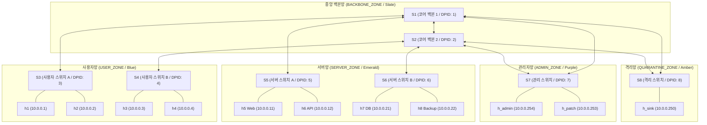
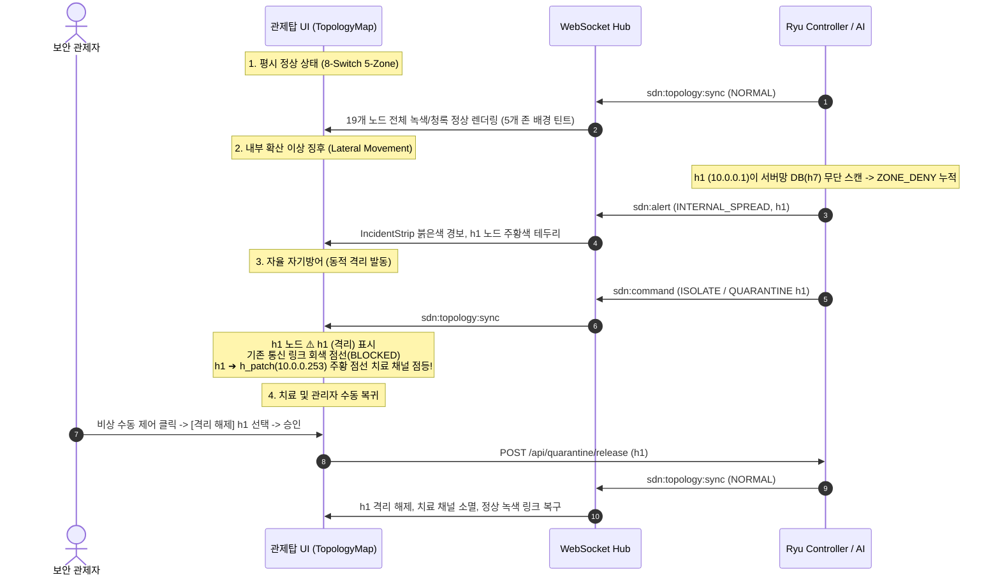

# Phase 6-C-2: 웹 관제탑 UI 전면 개편 및 존(Zone) 기반 대규모(8-스위치) 시각화 상세 구현 계획서

## 1. 개요 및 목적 (Executive Summary)

본 문서는 **종합 로드맵([ROADMAP.md](file:///home/tlgus/programming/Self_Defending_SDN_Tower/docs/planning/ROADMAP.md))의 Phase 6-C-2**에 명시된 **"웹 관제탑 UI 전면 개편 & 존(Zone) 기반 시각화"**의 상세 엔지니어링 구현 계획서입니다.

현 시스템(React 18, Tailwind CSS, vis-network, FastAPI WebSocket Hub)의 구조적 강점과 282개 테스트 무결성을 100% 계승하면서, **Phase 6-C-1에서 확장되는 8-스위치(S1~S8), 11-호스트(총 19개 노드) 대규모 존(Zone) 인프라**를 직관적이고 미려하게 관제할 수 있도록 웹 프론트엔드를 대대적으로 고도화합니다.

* **핵심 가치**:
  1. **물리 좌표 하드코딩 탈피**: 기존 4-스위치 단일 `SEED`를 벗어나, 8-스위치 존(Zone) 토폴로지 자동 배치 매트릭스 및 듀얼 모드(4-스위치/8-스위치) 자동 전환 엔진 구축.
  2. **5대 보안 존(Zone) 시각적 클러스터링**: vis-network 캔버스 렌더링 훅을 활용하여 백본, 사용자, 서버, 관리자, 격리망 영역을 구별하는 반투명 존 배경 및 라벨 렌더링.
  3. **L4 치료 채널(Quarantine Safe Channel) 점선 시각화**: 호스트가 격리(`QUARANTINED`)되었을 때, 전면 차단선(회색 점선)과 함께 오직 패치 서버(`H_Patch`, `10.0.0.253:80`)로만 통신이 허용되는 특수 치료 채널(주황/청록 점선 화살표)을 동적으로 표시.
  4. **대규모 노드 관제 최적화**: 20개 이상 노드 환경에서 노드 겹침을 방지하는 **계층형(Hierarchical) 레이아웃 모드 토글** 및 포트 통계 존(Zone)별 필터 탭 지원.
  5. **비상 수동 제어(ManualControl) 동적화**: 고정된 3개 단말 셀렉트박스를 탈피하여 토폴로지 노드로부터 실시간 호스트/존을 그룹화하여 추출하고, 최고 관리자 단말(H_Admin/H_Patch)에 대한 격리 보호 가드 적용.

---

## 2. 8-스위치 존(Zone) 토폴로지 UI 데이터 모델 및 아키텍처

### 2.1 5대 보안 존(Zone) 및 노드 배치 체계



### 2.2 존(Zone)별 UI 테마 및 색상 규격 (Spec §5 계승 & 확장)

| 존 이름 (Zone ID) | 담당 인프라 노드 | 테마 색상 (Hex / RGB) | 배경 구역 틴트 (`beforeDrawing`) | 뱃지/테두리 스타일 |
| :--- | :--- | :--- | :--- | :--- |
| **BACKBONE_ZONE** | `s1`, `s2` | Slate (`#64748b`) | `rgba(100, 116, 139, 0.08)` | 백본 코어 라벨, 더블 테두리 |
| **USER_ZONE** | `s3`, `s4`, `h1~h4` | Blue (`#3b82f6`) | `rgba(59, 130, 246, 0.08)` | 업무 PC 단말, 침해 위험 모니터링 |
| **SERVER_ZONE** | `s5`, `s6`, `h5~h8` | Emerald (`#10b981`) | `rgba(16, 185, 129, 0.08)` | 보호 서버 자산, 기본 화이트리스트 |
| **ADMIN_ZONE** | `s7`, `h_admin`, `h_patch` | Purple (`#a855f7`) | `rgba(168, 85, 247, 0.08)` | 관제탑 PC & 치료 패치 서버 (격리 불가) |
| **QUARANTINE_ZONE** | `s8`, `h_sink` | Amber (`#f59e0b`) | `rgba(245, 158, 11, 0.08)` | 침해 분석 싱크홀 & 차단 격리 구역 |

---

## 3. 핵심 컴포넌트별 개편 명세

### 3.1 토폴로지 레이아웃 엔진 (`ui/src/lib/topologyLayout.js` 신설)

기존 `TopologyMap.jsx` 내부의 고정된 `SEED` 상수를 별도의 전문 레이아웃 모듈로 분리하여 모듈화 및 단위 테스트 용이성을 극대화합니다.

1. **자동 모드 감지 (Topology Mode Auto-Detection)**:
   * 수신된 `topology.nodes` 중 스위치 수가 4개 이하인 경우: `diamond_4sw` 프로파일 적용.
   * 스위치 수가 5개 이상(8-스위치)인 경우: `zone_8sw` 프로파일 자동 전환.
2. **8-스위치 시드 좌표 매트릭스 (`SEED_8SW`)**:
   * **Core Tier ($y = -180$)**: `s1: [-140, -180]`, `s2: [140, -180]`
   * **Edge Tier ($y = -20$)**:
     * User: `s3: [-320, -20]`, `s4: [-160, -20]`
     * Server: `s5: [160, -20]`, `s6: [320, -20]`
     * Admin & Quarantine: `s7: [0, 80]`, `s8: [0, 220]`
   * **Host Tier ($y = 120 \sim 320$)**:
     * `h1: [-360, 100]`, `h2: [-280, 100]`
     * `h3: [-200, 100]`, `h4: [-120, 100]`
     * `h5: [120, 100]`, `h6: [200, 100]`
     * `h7: [280, 100]`, `h8: [360, 100]`
     * `h_admin: [-70, 160]`, `h_patch: [70, 160]`
     * `h_sink: [0, 300]`
3. **존 판별 헬퍼 (`getNodeZone(node)`)**:
   * 노드 객체에 `zone` 필드가 있으면 최우선 반영.
   * 없는 경우 ID 규칙(`h1~h4`, `s3~s4` -> `USER_ZONE`, `h5~h8`, `s5~s6` -> `SERVER_ZONE`, `s7`, `h_admin`, `h_patch` -> `ADMIN_ZONE`, `s8`, `h_sink` -> `QUARANTINE_ZONE`, `s1`, `s2` -> `BACKBONE_ZONE`)으로 100% 자동 추론.

---

### 3.2 `TopologyMap.jsx` 전면 개편

#### A. vis-network 캔버스 존(Zone) 배경 페인팅 (`beforeDrawing`)
* vis-network의 `beforeDrawing` 캔버스 컨텍스트 이벤트를 구독하여, 노드가 그려지기 전 배경 레이어에 각 존의 바운딩 박스와 반투명 배경색 및 존 헤더 텍스트를 렌더링.
* 사용자가 노드를 드래그하거나 화면을 줌/이동하더라도 캔버스 좌표계(`network.canvasToDOM`, `DOMtoCanvas`)와 동기화되어 깔끔한 구역감을 제공.

#### B. L4 격리 통신 제한선 (Quarantine Safe Channel Link) 렌더링
* 호스트가 침해되어 `QUARANTINED` 상태가 된 경우:
  1. 스위치와 호스트 간 기존 정상 링크는 회색 점선(`BLOCKED`, `#64748b`)으로 렌더링.
  2. 격리된 호스트 노드에서 물리 패치 서버(`h_patch`, `10.0.0.253`)로 이어지는 **"가상 안전 치료 채널"** 링크를 동적으로 생성하여 주황색 점선 + 화살표 애니메이션(`QUARANTINE_SAFE`, `#f97316`)으로 렌더링.
  3. 링크 툴팁에 `"L4 격리 치료 채널: TCP 80 (패치 다운로드 허용)"` 표시.

#### C. 계층형 레이아웃 모드 토글 (Hierarchical View Toggle)
* 패널 우측 상단에 `[클러스터 뷰]` / `[계층형 정렬]` 토글 스위치 제공.
* 계층형 활성화 시 vis-network 옵션을 `layout.hierarchical = { direction: "UD", sortMethod: "directed", levelSeparation: 120 }`로 동적 전환하여 19개 노드를 수직 3단(Backbone -> Switch -> Host)으로 정렬.

---

### 3.3 `PortStatsPanel.jsx` & `format.js` 포트 텔레메트리 확장

1. **`format.js` 동적 포트 레이블러 (`getPortLabel`)**:
   * 하드코딩된 `PORT_NAMES` 맵을 8-스위치 지원 맵으로 확장 및 동적 포트 생성기 구현:
     * `s1:1` -> "Core S2", `s1:2` -> "User S3", `s1:3` -> "Server S5", `s1:4` -> "Admin S7", `s1:5` -> "Quar S8"
     * `s2:1` -> "Core S1", `s2:2` -> "User S4", `s2:3` -> "Server S6", `s2:4` -> "Admin S7", `s2:5` -> "Quar S8"
     * `s3:1` -> "H1 (사무1)", `s3:2` -> "H2 (사무2)", `s3:99` -> "Trunk S1"
     * `s4:1` -> "H3 (영업1)", `s4:2` -> "H4 (영업2)", `s4:99` -> "Trunk S2"
     * `s5:1` -> "H5 (Web)", `s5:2` -> "H6 (API)", `s5:99` -> "Trunk S1"
     * `s6:1` -> "H7 (DB)", `s6:2` -> "H8 (Backup)", `s6:99` -> "Trunk S2"
     * `s7:1` -> "H_Admin", `s7:2` -> "H_Patch", `s7:98` -> "Trunk S1", `s7:99` -> "Trunk S2"
     * `s8:1` -> "H_Sinkhole", `s8:98` -> "Trunk S1", `s8:99` -> "Trunk S2"
2. **존(Zone) 기반 필터 탭 바 (Port Filter Tabs)**:
   * 포트가 24개 이상으로 늘어남에 따라 스크롤 압박을 해소하기 위한 탭 UI 제공:
     * `[전체 보기]`
     * `[사용자망 (S3, S4)]`
     * `[서버망 (S5, S6)]`
     * `[관리/격리망 (S7, S8)]`
     * `[백본망 (S1, S2)]`
   * 경보(`ATTACK_DETECTED`) 발생 시 해당 포트가 속한 탭에 붉은색 뱃지(`!`)를 표시하여 즉시 탐지 가능하도록 개선.

---

### 3.4 `ManualControl.jsx` 비상 수동 제어 패널 확장

1. **동적 타깃 목록 바인딩 (Dynamic Target Extraction)**:
   * 고정된 3개 호스트 배열(`TARGETS`) 대신, 부모로부터 전달받은 `topology.nodes` 중 호스트 노드(`node_type === 'host'`)를 추출하여 실시간 셀렉트박스 생성.
2. **존(Zone)별 `<optgroup>` 그룹핑**:
   * 셀렉트박스 내부를 존별로 분류하여 가독성 증대:
     * 사용자망: `h1 (10.0.0.1)`, `h2 (10.0.0.2)`, `h3 (10.0.0.3)`, `h4 (10.0.0.4)`
     * 서버망: `h5 Web (10.0.0.11)`, `h6 API (10.0.0.12)`, `h7 DB (10.0.0.21)`, `h8 Backup (10.0.0.22)`
     * 관리자망: `h_admin (10.0.0.254)`, `h_patch (10.0.0.253)`
     * 격리망: `h_sink (10.0.0.250)`
3. **최고 관리망 영구 보호 가드 (Whitelist Protection)**:
   * `h_admin` 및 `h_patch`를 선택한 경우 `"포트 격리"` 라디오 버튼 비활성화 및 경고 안내 (`관리망 단말은 격리할 수 없습니다`).
4. **격리 해제(RELEASE) 타깃 확장**:
   * 격리 상태(`QUARANTINED`)인 단말만 모아서 보여주는 `"격리 해제 대상"` 필터를 지원하여 직관적 복구 지원.

---

## 4. 단계별 상세 실행 마일스톤 (Milestones M1 ~ M5)

| 마일스톤 | 핵심 작업 내용 | 대상 파일 | 검증 방법 |
| :--- | :--- | :--- | :--- |
| **M1: 레이아웃 엔진 분리 & 듀얼 모드 좌표 구축** | • `topologyLayout.js` 신설 (`SEED_8SW`, `SEED_4SW`, `getNodeZone`)<br>• `format.js`에 8-스위치 포트 동적 명명 규칙(`getPortLabel`) 구현 | `ui/src/lib/topologyLayout.js`<br>`ui/src/lib/format.js` | Vitest 기반 좌표 분기 및 존 판별 단위 테스트 Pass |
| **M2: 존(Zone) 배경 페인팅 & 격리 제한선 시각화** | • `TopologyMap.jsx`에 vis-network `beforeDrawing` 캔버스 존 박스 구현<br>• `QUARANTINED` 상태 단말 -> `h_patch` 점선 가상 링크 동적 주입 | `ui/src/components/TopologyMap.jsx` | 브라우저 상에서 5대 존 배경 틴트 및 격리 링크 확인 |
| **M3: 계층형 뷰 토글 & 인터랙션 튜닝** | • 토폴로지 패널 상단에 `[클러스터 / 계층형]` 뷰 전환 스위치 추가<br>• 20개 노드 환경 줌/팬/드래그 시 캔버스 반응성 및 60 FPS 보장 | `ui/src/components/TopologyMap.jsx` | 계층형 정렬 클릭 시 노드 충돌 없이 3단 정렬 검증 |
| **M4: 텔레메트리 탭 & 수동 제어 동적화** | • `PortStatsPanel.jsx`에 존별 탭 필터 UI 구현<br>• `ManualControl.jsx`에 토폴로지 기반 동적 타깃 `<optgroup>` 및 보호 가드 | `ui/src/components/PortStatsPanel.jsx`<br>`ui/src/components/ManualControl.jsx` | 포트 필터링 클릭 및 단말 격리/해제 대화상자 정상 동작 확인 |
| **M5: 단위 테스트 갱신 & 프로덕션 빌드 무결성** | • `TopologyMap.test.js` 8-스위치 듀얼 모드 테스트 케이스 보강<br>• Docker UI 멀티스테이지 빌드(`Dockerfile.ui`) 100% 정상 통과 검증 | `ui/src/components/TopologyMap.test.js`<br>`ui/Dockerfile.ui` | `npm run build` 및 Vitest 전수 통과 확인 |

---

## 5. 검증 전략 및 테스트 케이스

### 5.1 단위 테스트 확장 계획 (`ui/src/components/TopologyMap.test.js`)
1. **듀얼 모드 회귀 방지 테스트**:
   * 4-스위치 노드 세트 입력 시 기존 `SEED` 좌표와 100% 동일하게 맵핑되는지 검증 (하위 호환성).
   * 8-스위치 노드 세트 입력 시 `SEED_8SW` 좌표로 올바르게 확장 맵핑되는지 검증.
2. **존(Zone) 분류 및 색상 매핑 검증**:
   * `s1~s8` 및 `h1~h8`, `h_admin`, `h_patch`, `h_sink`의 존 ID 판별 정확도 100% 검증.
3. **격리 치료 가상 링크(Quarantine Safe Channel) 생성 검증**:
   * 노드 중 `h1.status === "QUARANTINED"`일 때, `h1`과 `h_patch` 사이의 가상 링크가 정상 주입되는지 검증.
   * `status === "NORMAL"`일 때는 가상 링크가 생성되지 않는지 검증.

### 5.2 Nginx 프로덕션 번들 빌드 검증
```bash
# Docker 기반 프로덕션 UI 빌드 무결성 확인
docker build -t sdn-ui-test -f ui/Dockerfile.ui ui/
```

---

## 6. 최종 8-스위치 E2E 시연 데모 시나리오 (UI 관제탑 중심)



---

## 7. 향후 연계 사항 (Phase 6-C-1 및 백엔드와의 호환성)

* 본 계획서(Phase 6-C-2)의 UI 컴포넌트 개편은 **Phase 6-C-1의 8-스위치 인프라가 배포되기 전 Mock 데이터 및 4-스위치 환경에서도 완벽히 동작하도록 '듀얼 모드' 설계**를 기본으로 채택합니다.
* 따라서 UI 개편 작업을 선행 또는 병행하더라도 백엔드나 기존 인프라에 어떤 장애나 사이드 이펙트도 유발하지 않습니다.
