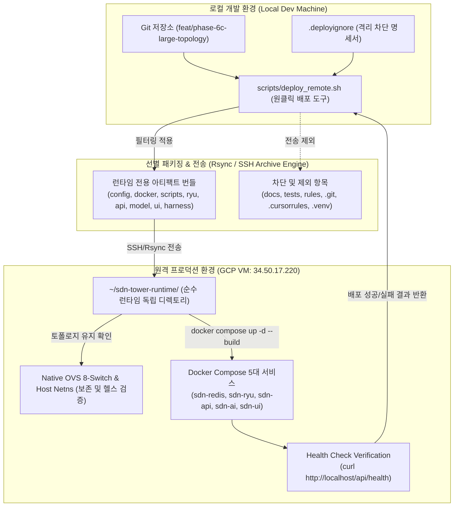

# Phase 6-C-3: 경량 런타임 아티팩트 분리 및 원클릭 배포 파이프라인 구축 상세 구현 계획서

## 1. 개요 및 목적 (Executive Summary)

본 문서는 **종합 로드맵([ROADMAP.md](file:///home/tlgus/programming/Self_Defending_SDN_Tower/docs/planning/ROADMAP.md))의 Phase 6-C-3**에 명시된 **"경량 런타임 아티팩트 분리 및 원클릭 배포 파이프라인 구축 (방안 1)"**의 상세 엔지니어링 구현 계획서입니다.

현재까지는 로컬 개발 저장소의 브랜치(`feat/phase-6c-large-topology`)를 VM의 Git 작업 폴더로 직접 `git push`하는 방식을 사용했습니다. 그러나 이 방식은 **학술 논문 원고(`docs/thesis/thesis_draft.md`), 발표 대본, 내부 기획서/로드맵 등 런타임과 무관한 기밀 자산이 외부 VM에 그대로 노출**되고, 289개 테스트 스위트(`tests/`)와 개발 설정이 함께 올라가며, VM 상의 로그나 임시 변경으로 인해 Git 충돌(Dirty State)이 발생하는 명확한 한계를 지닙니다.

이에 따라 본 계획에서는 **비런타임 자산(문서/테스트/개발 규칙/Git 히스토리)을 100% 원천 차단**하고, 오직 프로덕션 실행에 필요한 **런타임 아티팩트(소스 코드, 설정 파일, 배포 스크립트, Docker 컨테이너 자산)**만을 선별하여 VM의 독립 런타임 디렉토리로 안전하게 초고속(수 초 내) 배포하는 자동화 파이프라인을 구축합니다.

---

### 1.1 핵심 가치 및 해결 과제

1. **학술 자산 및 내부 문서의 완전한 보안 격리**:
   - `docs/`(논문 원고, 기획서, 발표자료), `rules/`(.cursorrules 등 AI 에이전트 지침), Git 히스토리(`.git/`)를 VM 배포 대상에서 완전히 배제하여 외부 노출을 원천 방지.
2. **런타임 디렉토리 분리로 Git 충돌 제거**:
   - VM 상에서 `~/sdn-tower-runtime`이라는 순수 런타임 작업 디렉토리를 분리 운용하여, 로컬 Git 브랜치와의 상태 불일치나 충돌을 근본적으로 제거.
3. **초고속 원클릭 배포 및 무중단 파이프라인**:
   - 단 한 번의 명령어(`./scripts/deploy_remote.sh 34.50.17.220`)로 `선별 패키징 ➔ SSH/rsync 초고속 전송 ➔ OVS 상태 검증 ➔ Docker 컨테이너 무중단 빌드/기동 ➔ /api/health 자동 검증`을 5초 이내에 일괄 완결.
4. **향후 Phase 6-G (Docker Registry 기반 제로 소스 배포)와의 완벽한 호환**:
   - 배포 스크립트에 플래그 구조를 선제적으로 설계하여, 차기 상용화 단계에서 사전 빌드된 컨테이너 이미지(GHCR/GAR) 배포 모드로 원클릭 확장 지원.

---

## 2. 배포 파이프라인 아키텍처 및 파일 격리 명세

### 2.1 배포 워크플로우 아키텍처



---

### 2.2 배포 대상(Inclusion) vs 제외 대상(Exclusion) 매트릭스

| 분류 | 대상 디렉토리 및 파일 | 처리 방식 | 사유 |
| :--- | :--- | :---: | :--- |
| **보안 제외 자산** | `docs/` | **완전 배제** | 학술 졸업논문(`thesis_draft.md`), 발표 대본, 내부 기획서 유출 방지 |
| **개발 규칙/프롬프트**| `rules/`, `.cursorrules` | **완전 배제** | AI 개발 가이드라인 및 프로젝트 내부 프롬프트 외부 노출 차단 |
| **테스트 스위트** | `tests/` | **완전 배제** | 289개 테스트 코드는 로컬/CI에서만 수행, VM 런타임 용량 최적화 |
| **버전 관리 메타데이터**| `.git/`, `.gitignore` | **완전 배제** | VM 환경의 Git 의존성 제거 및 브랜치 상태 불일치/충돌 원천 차단 |
| **가상환경/임시파일** | `.venv/`, `__pycache__/`, `runs/`, `node_modules/` | **완전 배제** | 로컬 OS/Python 바이너리 및 빌드 임시 파일 혼입 방지 |
| **핵심 설정 파일** | `config/` (`topology.yaml`, `zones.yaml`, `topology_profiles.yaml`) | **필수 포함** | 8-스위치 토폴로지 및 제로트러스트 보안 존 정책 SSOT |
| **오케스트레이션** | `docker-compose.yml`, `docker/` | **필수 포함** | 5대 프로덕션 컨테이너 정의 및 Dockerfile 빌드 컨텍스트 |
| **백엔드/제어기 소스** | `ryu/`, `api/`, `model/`, `harness/`, `pipeline/`, `traffic/` | **필수 포함** | OpenFlow 제어기, REST API, AI 추론 워커 런타임 소스 |
| **웹 프론트엔드 소스**| `ui/` (`src/`, `public/`, `package.json`, `index.html`, `vite.config.js` 등) | **필수 포함** | Nginx 컨테이너 멀티스테이지 정적 빌드 필수 자산 |
| **운영/토폴로지 스크립트**| `scripts/` (`setup_large_ovs.sh`, `cleanup_large_ovs.sh`, `prod_stack.sh` 등) | **필수 포함** | Native OVS 브릿지 구성 및 네임스페이스 기동 스크립트 |
| **패키지 정의** | `pyproject.toml` | **필수 포함** | Python 의존성 메타데이터 |

---

## 3. 5단계 세부 구현 마일스톤 (Milestones M1 ~ M5)

### 📌 Milestone M1: 런타임 격리 명세서(`.deployignore`) 정의

- **작업 내용**:
  - 프로젝트 루트에 배포 제외 패턴을 정의한 `.deployignore` 파일 생성.
  - rsync의 `--exclude-from` 옵션 및 tar의 `--exclude-vcs-ignores` 규격과 100% 호환되도록 정밀 작성.
- **주요 정의 규칙**:
  ```text
  # 1. 문서 및 기밀 지적 자산
  docs/
  
  # 2. 테스트 스위트 및 벤치마크 로그
  tests/
  runs/
  *.log
  
  # 3. AI 개발 규칙 및 도구 설정
  rules/
  .cursorrules
  .vscode/
  .idea/
  
  # 4. 버전 관리 및 캐시
  .git/
  .gitignore
  .gitattributes
  __pycache__/
  *.pyc
  .pytest_cache/
  .mypy_cache/
  
  # 5. 로컬 가상환경 및 빌드 아티팩트
  .venv/
  ui/node_modules/
  ui/dist/
  ```

---

### 📌 Milestone M2: 원클릭 배포 스크립트(`scripts/deploy_remote.sh`) 개발

- **작업 내용**:
  - 로컬에서 원격 VM으로 런타임 아티팩트만 선별하여 초고속 동기화하고, 원격 서비스를 자동 갱신하는 종합 배포 도구 구현.
- **스크립트 주요 기능 및 매개변수**:
  - `USAGE: ./scripts/deploy_remote.sh [VM_IP_OR_HOST] [OPTIONS]`
  - `--target <IP>`: 대상 VM 주소 지정 (기본값: `34.50.17.220`)
  - `--dest-dir <DIR>`: VM 상의 런타임 디렉토리 지정 (기본값: `~/sdn-tower-runtime`)
  - `--user <USER>`: SSH 접속 사용자 (기본값: `tlgus1841`)
  - `--no-build`: 컨테이너 재빌드 없이 소스만 동기화 및 재시작
  - `--dry-run`: 실제 전송 없이 전송 대상/제외 대상 파일 목록만 시뮬레이션 출력
  - `--check-only`: VM의 OVS 상태 및 Docker 헬스 상태만 원격 점검
- **파이프라인 실행 시퀀스**:
  1. SSH 연결성 및 필수 도구(`rsync`, `docker`, `ovs-vsctl`) 사전 점검.
  2. 로컬 `.deployignore`를 적용하여 런타임 파일만 VM의 `~/sdn-tower-runtime`으로 동기화.
  3. VM 상의 OVS 8-스위치 토폴로지 기동 여부 확인 (미기동 시 안내 또는 자동 기동 옵션).
  4. VM 런타임 디렉토리에서 `docker compose up -d --build` 무중단 롤링 재기동 수행.
  5. 배포 완료 후 `http://<VM_IP>/api/health` 및 `http://<VM_IP>/api/topology` 실시간 헬스체크 검증.

---

### 📌 Milestone M3: VM 런타임 독립 디렉토리 체계 확립

- **작업 내용**:
  - 기존 Git 저장소 디렉토리(`~/sdn-tower`)와 별개로, VM 내 순수 런타임 디렉토리(`~/sdn-tower-runtime`)를 신설.
  - OVS 브릿지(`s1`~`s8`)와 네임스페이스는 호스트 커널 자원이므로 디렉토리 변경에 영향받지 않음을 보장.
  - 패치 서버(`/tmp/sdn_patch_root/`) 및 백그라운드 데몬과의 연동 경로를 런타임 디렉토리 기준으로 표준화.

---

### 📌 Milestone M4: 자동 헬스체크 및 롤백 안전장치

- **작업 내용**:
  - 배포 후 최대 30초 동안 3초 간격으로 `http://<VM_IP>/api/health`를 폴링하여 컨테이너 정상 기동을 자동 판정.
  - 정상 응답(`"status": "ok"`, `"mode": "live"`) 수신 시 배포 성공 메시지와 실시간 웹 대시보드 URL 출력.
  - 기동 실패 또는 비정상 응답 시 즉각 `docker compose logs` 요약을 로컬 터미널에 출력하여 배포 직후 디버깅 편의 제공.

---

### 📌 Milestone M5: 파이프라인 무결성 검증 및 로컬 테스트

- **작업 내용**:
  - `tests/scripts/test_deploy_filter.py` (또는 유닛 테스트)를 통해 `.deployignore` 적용 시 `docs/`, `tests/`, `.git/` 파일이 전송 목록에 단 1건도 포함되지 않음을 검증.
  - 로컬에서 `--dry-run` 모드로 실행하여 번들 크기가 대폭 축소(전체 용량 대비 80% 이상 절감)됨을 정량 측정.

---

## 4. 검증 기준 및 완료 정의 (Definition of Done)

| 번호 | 검증 항목 | 검증 방법 및 합격 기준 |
| :---: | :--- | :--- |
| **DoD-1** | **문서 및 기밀 파일 격리** | 배포 후 VM `~/sdn-tower-runtime` 내에 `docs/`, `rules/`, `.cursorrules`가 존재하지 않아야 함 (`find ~/sdn-tower-runtime -name "thesis_draft.md"` 결과 0건) |
| **DoD-2** | **테스트 및 Git 격리** | VM `~/sdn-tower-runtime` 내에 `tests/`, `.git/` 디렉토리가 존재하지 않아야 함 |
| **DoD-3** | **원클릭 배포 성공** | `./scripts/deploy_remote.sh` 단일 명령어로 전송 ➔ 빌드 ➔ 기동 ➔ 헬스체크까지 에러 없이 완료 |
| **DoD-4** | **웹 관제탑 서비스 무중단** | 배포 완료 후 `http://34.50.17.220/` (UI 포트 80) 및 `http://34.50.17.220/api/health`가 HTTP 200 정상 반환 |
| **DoD-5** | **로컬 테스트 스위트 보존** | 로컬 환경에서 `pytest` 289개 테스트가 100% 통과 유지되어야 함 |

---

## 5. 단계별 실행 일정 (Timeline)

| 마일스톤 | 작업 내용 | 예상 소요 시간 | 상태 |
| :--- | :--- | :---: | :---: |
| **M1** | 런타임 격리 명세서(`.deployignore`) 정의 | 0.5시간 | 대기 |
| **M2** | 원클릭 배포 스크립트(`scripts/deploy_remote.sh`) 구현 | 1.5시간 | 대기 |
| **M3** | VM 런타임 독립 디렉토리 체계 검증 및 OVS 연동 확인 | 1.0시간 | 대기 |
| **M4** | 자동 헬스체크 및 롤백 안전장치 구축 | 0.5시간 | 대기 |
| **M5** | 파이프라인 무결성 검증 (배포 테스트) | 0.5시간 | 대기 |
| **합계** | **Phase 6-C-3 전체 완료** | **약 4시간 (0.5일)** | **준비 완료** |
