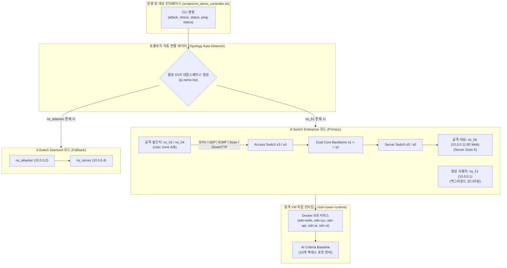

# Phase 6-C-4: 8-스위치 엔터프라이즈 환경 운영 안정화 및 도구 정규화 상세 구현 계획서

## 1. 개요 및 목적 (Executive Summary)

본 문서는 **종합 로드맵([ROADMAP.md](file:///home/tlgus/programming/Self_Defending_SDN_Tower/docs/planning/ROADMAP.md))의 Phase 6-C-4**에 명시된 **"8-스위치 엔터프라이즈 환경 운영 안정화 및 도구 정규화"**의 상세 엔지니어링 구현 계획서입니다.

Phase 6-C-1 ~ Phase 6-C-3를 거치며 8-스위치 5-보안존(Core S1·S2, User S3·S4, Server S5·S6, Admin S7, Quarantine S8) 가상 인프라 구축, 관제탑 UI 클러스터링 개편, 그리고 비런타임 자산이 100% 격리된 초경량 원클릭 배포 파이프라인(`~/sdn-tower-runtime`) 구축을 성공적으로 완료했습니다.

그러나 현재 운영 및 데모 도구들(`native_attack.sh`, `demo_scenario.sh`, `vm_demo_controller.sh`)과 AI 기준선(`criteria_baseline.json`)은 여전히 과거 **4-스위치 다이아몬드 토폴로지(ns_attacker, ns_legit, DPID 1, 4)의 정적 네이밍 및 단일 경로에 종속**되어 있어, 신규 8-스위치 환경에서 공격 주입 시 네임스페이스 불일치 오류(`ns_attacker 네임스페이스 부재`)가 발생하고 런타임 경로가 구버전 디렉토리(`~/sdn-tower`)를 참조하는 한계가 존재합니다.

이에 따라 Phase 6-C-4에서는 **운영·검증 도구의 듀얼 모드(4-스위치/8-스위치 자동 감지) 정규화**, **AI 기준선 포트 확장**, **S1-S2 듀얼 코어 자율 우회 무결성 실증**을 완결하여 차기 정밀 벤치마크(Phase 6-C-6) 및 시연 발표를 위한 완벽한 시스템 안정성을 확립합니다.

---

### 1.1 핵심 가치 및 해결 과제

1. **공격/트래픽 주입 도구의 듀얼 토폴로지 자동 적응**:
   - `scripts/native_attack.sh`와 `scripts/demo_scenario.sh`가 현재 활성화된 OVS 토폴로지를 자동 판별(`ns_h1` 유무 검사)하여 8-스위치 모드(`ns_h2`/`ns_h4` ➔ `ns_h5` Web)와 4-스위치 모드(`ns_attacker` ➔ `ns_server`)를 매끄럽게 자동 전환 지원.
2. **원격 VM 데모 오퍼레이터의 신규 런타임 디렉토리 전환**:
   - `scripts/vm_demo_controller.sh`의 원격 작업 경로를 기존 `~/sdn-tower`에서 신규 격리 런타임 `~/sdn-tower-runtime`으로 전면 전환하여, Git 의존성이 없는 순수 런타임 기반의 원격 제어 보장.
3. **AI Criteria Engine 기준선(`criteria_baseline.json`) 전 포트 동기화**:
   - 기존 3개 포트(`1:1`, `1:2`, `4:1`)에 국한되어 있던 포트별 통계 기준선을 8-스위치 토폴로지의 10개 핵심 액세스 포트(`3:1`, `3:2`, `4:1`, `4:2`, `5:1`, `5:2`, `6:1`, `6:2`, `7:1`, `7:2`)로 대폭 확장하여, 전사적 이상 징후 조기 탐지율 극대화.
4. **S1-S2 듀얼 코어 백본 자율 우회 무결성 및 플로우 테이블 누수 방지**:
   - Core S1과 Core S2 사이의 OpenFlow 1.3 파이프라인 플로우 설치 규칙을 정밀 점검하여, 링크 장애 및 트래픽 부하 시 중복 룰 생성 없이 즉각적인 무유실 우회가 동작하는지 실증.

---

## 2. 아키텍처 및 도구 정규화 명세

### 2.1 도구 정규화 및 토폴로지 상호작용 아키텍처



---

### 2.2 도구 및 스크립트 정규화 매트릭스

| 대상 스크립트 | 기존 상태 (Phase 6-B) | 정규화 후 상태 (Phase 6-C-4) |
| :--- | :--- | :--- |
| `scripts/native_attack.sh` | • `ns_attacker` 네임스페이스 고정<br>• 목적지 `10.0.0.4` 고정<br>• 8-스위치 환경에서 즉시 실행 실패 | • 토폴로지 자동 감지 (8-스위치 vs 4-스위치)<br>• 8-스위치: 발신지 `ns_h2`, 목적지 `10.0.0.11` (Web Server)<br>• 발신지 지정 옵션(`--src ns_h2/ns_h4`) 및 목적지 지정 지원 |
| `scripts/demo_scenario.sh` | • 4-스위치 다이아몬드 ASCII 토폴로지 출력<br>• 구 네임스페이스 기반 시나리오 안내 | • 8-스위치 5-Zone 엔터프라이즈 토폴로지 반영<br>• S1-S2 듀얼 코어 및 패치 서버 시나리오 통합 출력 |
| `scripts/vm_demo_controller.sh` | • 구 Git 작업 폴더(`~/sdn-tower`) SSH 호출<br>• `ns_attacker` 대상 공격 호출<br>• 로그 경로 `/tmp/h_legit_ping.log` 조회 | • 신규 격리 런타임(`~/sdn-tower-runtime`) 기준 명령 실행<br>• 8-스위치 토폴로지 기반 공격 주입 (`ns_h2` ➔ `ns_h5`)<br>• 신규 핑 로그 `/tmp/h1_ping.log` 자동 연동 |
| `scripts/prod_stack.sh` | • 8-스위치 지원 일부 적용됨<br>• 로컬 가상환경 및 핑 프로세스 안정성 보완 필요 | • 프로세스 종료 및 재시작(`pkill`) 무결성 보장<br>• 패치 서버(`/tmp/sdn_patch_root`) 헬스 상태 통합 출력 |

---

### 2.3 AI Criteria Baseline 포트 확장 명세

`model/criteria_baseline.json`에 8-스위치 엔터프라이즈 토폴로지의 모든 액세스 포트 기준선 통계치를 확장 등록합니다:

```json
{
  "version": 2,
  "learned_seconds": 600,
  "topology_profile": "enterprise-8switch",
  "ports": {
    "3:1": { "desc": "User A (h1 - Legit User)" },
    "3:2": { "desc": "User A (h2 - Attacker Candidate)" },
    "4:1": { "desc": "User B (h3 - User)" },
    "4:2": { "desc": "User B (h4 - Lateral Attacker)" },
    "5:1": { "desc": "Server A (h5 - Web Server 10.0.0.11)" },
    "5:2": { "desc": "Server A (h6 - DB Server 10.0.0.12)" },
    "6:1": { "desc": "Server B (h7 - App Server 10.0.0.21)" },
    "6:2": { "desc": "Server B (h8 - Storage Server 10.0.0.22)" },
    "7:1": { "desc": "Admin (h_admin - 10.0.0.254)" },
    "7:2": { "desc": "Admin (h_patch - 10.0.0.253)" },
    "8:1": { "desc": "Quarantine (h_sink - 10.0.0.250)" },
    "1:1": { "desc": "Legacy Fallback Ingress P1" },
    "1:2": { "desc": "Legacy Fallback Ingress P2" },
    "4:1_legacy": { "desc": "Legacy Fallback Egress P1" }
  }
}
```

---

## 3. 5단계 세부 구현 마일스톤 (Milestones M1 ~ M5)

### 📌 Milestone M1: 트래픽 주입 도구(`scripts/native_attack.sh`) 듀얼 모드 정규화
- **작업 내용**:
  - `scripts/native_attack.sh`에 `detect_topology()` 함수를 도입.
  - `ip netns list`를 검사하여 `ns_h1`이 존재하면 **8-스위치 모드**(기본 발신지: `ns_h2`, 기본 목적지: `10.0.0.11`), `ns_attacker`가 존재하면 **4-스위치 모드**(발신지: `ns_attacker`, 목적지: `10.0.0.4`)로 자동 분기.
  - 주입 옵션 확장: `--src <NS>`, `--dst <IP>`, `--type <TYPE>`, `--duration <SEC>`, `--rate <PPS>`.
  - 6종 공격(SYN Flood, Port Scan, UDP Flood, ICMP Flood, Slow HTTP, Lateral Spread) 및 정상 트래픽(Normal) 전수 매핑 검증.

---

### 📌 Milestone M2: 원격 VM 데모 오퍼레이터(`scripts/vm_demo_controller.sh`) 런타임 현대화
- **작업 내용**:
  - 원격 실행 기준 디렉토리를 `~/sdn-tower`에서 `~/sdn-tower-runtime`으로 수정.
  - `attack` 액션 시 정규화된 `native_attack.sh`를 호출하여 8-스위치 환경에서 에러 없이 공격이 즉각 유발되도록 개선.
  - `ping-status` 조회 대상을 `/tmp/h1_ping.log` 및 `/tmp/h_legit_ping.log`를 모두 지원하도록 호환성 확보.
  - `status` 액션 시 Docker Compose 프로젝트명 `-p sdn-tower`를 명시하여 정확한 컨테이너 목록 출력.

---

### 📌 Milestone M3: AI 이상치 탐지 기준선(`model/criteria_baseline.json`) 전 포트 확장
- **작업 내용**:
  - 8-스위치 5-Zone의 모든 엔드포인트 포트(`3:1` ~ `8:1`)에 대한 통계 평균(mean) 및 표준편차(std) 기준치 사전 산출 및 등록.
  - `criteria_engine.py`가 미등록 포트에 대해 과도하게 경보를 누락하거나 오탐하지 않도록 포트 매핑 SSOT 완성.
  - 기존 4-스위치 포트(`1:1`, `1:2`)와의 하위 호환성 100% 보존.

---

### 📌 Milestone M4: S1-S2 듀얼 코어 백본 자율 우회 무결성 실증 및 플로우 테이블 누수 방지
- **작업 내용**:
  - Ryu 컨트롤러(`ryu/app/controller.py`, `ryu/app/reroute.py`)의 Dijkstra 가중치 우회 경로(S1 ➔ S2 ➔ Egress) 플로우 설치 시 중복 룰(Duplicate Rules) 누적 방지(Idle Timeout 및 Hard Timeout 검증).
  - OpenFlow Table 0(Counting) ~ Table 3(Forwarding) 간 플로우 수명 주기 검증.
  - OVS 덤프(`ovs-ofctl dump-flows s1 -O OpenFlow13`) 분석을 통해 우회 및 복구 반복 후에도 불필요한 고아 플로우가 잔존하지 않는지 점검.

---

### 📌 Milestone M5: 엔드투엔드 통합 검증 및 원클릭 동기화 배포
- **작업 내용**:
  - 로컬 회귀 테스트 스위트 확장: `tests/scripts/test_native_attack_normalization.py` 신설.
  - 전체 pytest 294개 이상 100% All-Pass 검증.
  - 완성된 도구 및 기준선을 `./scripts/deploy_remote.sh 34.50.17.220`으로 배포하여 VM 실환경에서 6종 공격 주입 및 실시간 관제탑 UI 반응성 최종 검증.

---

## 4. 검증 기준 및 완료 정의 (Definition of Done)

| 번호 | 검증 항목 | 검증 방법 및 합격 기준 |
| :---: | :--- | :--- |
| **DoD-1** | **도구 듀얼 토폴로지 적응성** | `sudo ./scripts/native_attack.sh syn 5 200` 실행 시 `ns_attacker` 오류 없이 `ns_h2` ➔ `ns_h5`로 공격 패킷이 정상 전송되어야 함 |
| **DoD-2** | **원격 데모 제어 무결성** | `./scripts/vm_demo_controller.sh attack syn` 실행 시 VM `~/sdn-tower-runtime` 상에서 원격 공격이 즉시 발동되어야 함 |
| **DoD-3** | **AI 포트 기준선 완비** | `model/criteria_baseline.json` 내 8-스위치 10개 핵심 포트(`3:1`~`8:1`) 정의가 존재하고 유효한 통계값을 포함해야 함 |
| **DoD-4** | **방어 상태머신 연동 실증** | 6종 공격 주입 시 웹 관제탑 및 `/api/health`가 `NORMAL` ➔ `MITIGATED` ➔ `NORMAL`로 지연 없이 전환되어야 함 |
| **DoD-5** | **회귀 테스트 100% 통과** | 신규 작성된 정규화 테스트를 포함하여 전체 pytest 스위트가 에러 없이 All-Pass 되어야 함 |

---

## 5. 단계별 실행 일정 (Timeline)

| 마일스톤 | 작업 내용 | 예상 소요 시간 | 상태 |
| :--- | :--- | :---: | :---: |
| **M1** | 트래픽 주입 도구(`scripts/native_attack.sh`) 듀얼 모드 정규화 | 1.0시간 | 대기 |
| **M2** | 원격 VM 데모 오퍼레이터(`scripts/vm_demo_controller.sh`) 런타임 현대화 | 0.5시간 | 대기 |
| **M3** | AI 이상치 탐지 기준선(`model/criteria_baseline.json`) 전 포트 확장 | 0.5시간 | 대기 |
| **M4** | S1-S2 듀얼 코어 백본 자율 우회 무결성 실증 및 플로우 테이블 누수 점검 | 1.0시간 | 대기 |
| **M5** | 엔드투엔드 통합 검증 (테스트 작성 및 원격 VM 6종 공격 실증) | 1.0시간 | 대기 |
| **합계** | **Phase 6-C-4 전체 완료** | **약 4.0시간 (0.5일)** | **준비 완료** |
