# Phase 6-C-5: 웹 관제탑 가독성 및 UI/UX 정밀 개편 상세 구현 계획서

## 1. 개요 및 배경 (Executive Summary)

본 문서는 **종합 로드맵([ROADMAP.md](file:///home/tlgus/programming/Self_Defending_SDN_Tower/docs/planning/ROADMAP.md))의 Phase 6-C-5**에 명시된 **"웹 관제탑 가독성 및 UI/UX 정밀 개편 (UI Readability & Ergonomics)"**의 상세 엔지니어링 구현 계획서입니다.

Phase 6-C-1 ~ Phase 6-C-4를 거치며 8-스위치 5-보안존 인프라, 초경량 격리 배포 파이프라인, 그리고 운영 도구 표준화가 완료되어 백엔드/인프라는 완벽한 안정화 상태에 도달했습니다. 그러나 **사용자 피드백("지금 버전은 가독성이 떨어지는 것 같음")**과 실제 웹 화면 분석 결과, 프론트엔드 관제탑에 다음과 같은 심각한 가독성 저하 요인들이 확인되었습니다:

1. **캔버스 뷰포트 협소 및 중앙 노드 과밀 (Crowded Layout)**:
   - 19개 노드(스위치 8, 호스트 11)와 20개 링크가 좁은 캔버스(`h-[460px]`, `col-span-8`)에 밀집되어 있으며, 특히 관리자망(`s7`, `h_admin`, `h_patch`)이 중앙에 배치되어 사용자망 B와 서버망 A 사이의 간격이 50px 미만으로 지나치게 좁아 노드와 링크가 겹쳐 보임.
2. **시각적 계층화(Visual Hierarchy) 부족**:
   - 백본 코어 스위치(S1, S2), 엣지 스위치(S3~S8), 일반 PC(H1~H4), 고부하 서버(H5~H8), 보안 격리 단말이 거의 동일한 크기와 사각형/타원 형태로 표현되어 관제관이 한눈에 중요 노드를 식별하기 어려움.
3. **인터랙티브 Focus & Dimming 부재 (스파게티 링크 현상)**:
   - 20개의 링크 선이 교차하는 상황에서 특정 노드를 클릭하거나 마우스를 올려도 모든 링크가 동일한 밝기로 유지되어, 해당 노드가 정확히 어느 스위치/호스트와 연결되어 있는지 추적하기 극도로 피로함.
4. **텔레메트리 및 수치 데이터 가독성 개선 필요**:
   - `PortStatsPanel`의 24개 이상 포트 목록이 긴 텍스트 표 형태로 나열되어 있어, 트래픽 폭주 포트나 이상 포트를 직관적으로 인지하기 어려움.

본 계획서에서는 이러한 문제를 근본적으로 해결하여, **실제 대형 엔터프라이즈 SOC(보안관제센터) 수준의 직관적이고 쾌적한 가독성을 제공하는 프리미엄 관제탑 UI**를 완성합니다.

---

## 2. UI/UX 정밀 개편 5대 핵심 영역

### 2.1 아키텍처 및 화면 공간 최적화

```mermaid
flowchart TD
    subgraph ViewportOptimization ["1. 캔버스 뷰포트 & 레이아웃 확장"]
        Layout["DashboardLayout max-w-[1600px] 와이드 확장"]
        CanvasH["TopologyMap 높이 460px ➔ 580px 확대 (+26%)"]
        ToggleFS["전체화면 / 와이드 뷰 토글 지원"]
    end

    subgraph CoordinateRebalance ["2. 8-스위치 5-Zone 좌표계 리밸런싱"]
        TopCore["Top Tier: Core S1 <==> Core S2 (중앙 이중화 백본)"]
        UserZone["Left Wing: User Zone A & B (s3, s4, h1~h4)"]
        ServerZone["Right Wing: Server Zone A & B (s5, s6, h5~h8)"]
        AdminZone["Bottom-Left: Admin Zone (s7, h_admin, h_patch 253)"]
        QuarantineZone["Bottom-Right: Quarantine Zone (s8, h_sink 250)"]
    end

    subgraph VisualHierarchy ["3. 노드 & 링크 시각적 계층화"]
        CoreStyle["Core Switch: 대형 헥사곤/볼드 박스 (크기 45px, 듀얼 테두리)"]
        EdgeStyle["Edge Switch: 중형 라운드 박스 (크기 32px)"]
        ServerStyle["Server Host: 서버 랙 실린더 심볼 + 서비스명 태그 (Web, DB)"]
        HostStyle["Client Host: 콤팩트 서클 (크기 24px)"]
        TrunkEdge["Trunk Link: 굵은 이중 라인 (width: 4px)"]
        AccessEdge["Access Link: 간결 슬림 라인 (width: 2px)"]
    end

    subgraph FocusDimming ["4. 인터랙티브 Focus & Dimming 엔진"]
        HoverSelect["노드 선택 / 호버 시"]
        HighlightNeighbor["연결된 1-Hop 링크 및 이웃 노드: 100% 선명 강조"]
        DimUnrelated["비연관 노드 및 링크: 15% 투명도 (Dim) 처리"]
    end

    subgraph TelemetryErgonomics ["5. 텔레메트리 & 상태 가독성 개편"]
        PortCards["PortStats: 콤팩트 미니 카드 그리드 + 실시간 트래픽 게이지"]
        ZoneTint["Zone Background: 고대비 라운드 카드 + WCAG AA 폰트"]
    end

    ViewportOptimization --> CoordinateRebalance
    CoordinateRebalance --> VisualHierarchy
    VisualHierarchy --> FocusDimming
    FocusDimming --> TelemetryErgonomics
```

---

### 2.2 개선 전 vs 개선 후 상세 비교 매트릭스

| 영역 | 현재 상태 (Phase 6-C-2) | 개편 후 목표 상태 (Phase 6-C-5) |
| :--- | :--- | :--- |
| **대시보드 최대 폭** | `max-w-7xl` (1280px 고정, 대화면에서 좁음) | `max-w-[1600px]` 와이드 스크린 최적화 (여백 낭비 제거) |
| **토폴로지 캔버스 높이** | `h-[460px]` (19개 노드 수용 시 세로 답답함) | `h-[580px]` (시원한 세로 시야각 확보, +26% 확장) |
| **중앙 노드 배치** | 관리망(S7)이 중앙에 끼어 있어 좌우 간격 50px로 겹침 | **좌우 날개형(Wing) 분할 배치**: 좌측(User A/B), 우측(Server A/B), 하단 좌(Admin), 하단 우(Quarantine) |
| **노드 형태 및 크기** | 모든 스위치가 동일한 사각형, 모든 호스트가 동일한 타원 | • Core(S1, S2): 특대형 라운드 렉트 (48x48) + 글로우 • Edge(S3~S8): 표준 렉트 (34x34) • Server(H5~H8): 서버 심볼 뱃지 + IP 강조 • Host(H1~H4): 콤팩트 서클 (26x26) |
| **링크 교차 시인성** | 20개 선이 얽혀 링크 추적 불가능 | **Focus & Dimming**: 마우스 호버/클릭 시 연관 링크만 선명해지고 비연관 링크는 15%로 흐려짐 |
| **포트 툴팁 / 정보** | 브라우저 기본 텍스트 툴팁 (지연 발생) | **커스텀 리치 툴팁**: 포트 번호, 링크 종류(Trunk/Access), 실시간 PPS, 상태 즉시 표시 |
| **존(Zone) 배경 박스** | 연한 점선 사각형 (경계 식별 모호) | **세련된 글래스모피즘 카드**: 은은한 배경 틴트 + 명확한 상단 컬러 태그 바 |
| **PortStatsPanel** | 단순 테이블 스크롤 뷰 | **카드형 콤팩트 그리드**: PPS 트래픽 바 게이지 + 위험 포트 펄스 애니메이션 |

---

## 3. 5단계 세부 구현 마일스톤 (Milestones M1 ~ M5)

### 📌 Milestone M1: 캔버스 뷰포트 확장 및 좌표계 리밸런싱
- **작업 내용**:
  - `ui/src/layouts/DashboardLayout.jsx`: 대시보드 최대 너비를 `max-w-[1600px]`로 확장하여 캔버스 면적 극대화.
  - `ui/src/components/TopologyMap.jsx`: 패널 높이를 `h-[580px]`로 확장.
  - `ui/src/lib/topologyLayout.js`의 `SEED_8SW` 좌표 전면 재배치:
    - 코어 백본 S1, S2를 상단 중앙(`y = -190`)에 넓게 이중화 배치.
    - 좌측 윙: S3, S4 및 User 단말(H1~H4)을 좌측 영역(`x: -500 ~ -200`)에 여유롭게 배치.
    - 우측 윙: S5, S6 및 Server 단말(H5~H8)을 우측 영역(`x: 200 ~ 500`)에 정돈하여 배치.
    - 하단 영역: Admin 존(S7, H_Admin, H_Patch)과 Quarantine 존(S8, H_Sink)을 하단 좌/우로 완벽 분리하여 중앙 충돌 완전 해소.

---

### 📌 Milestone M2: 노드/엣지 시각적 계층화 및 Zone 클러스터링 카드 강화
- **작업 내용**:
  - `toVisNode()` 함수 리팩토링:
    - vis-network의 라벨 인라인 지원 쉐이프(`box`) 기반 `shapeProperties.borderRadius`를 활용하여 모던 필(Pill) & 라운드 박스 스타일링 적용.
    - **Core Switch (S1, S2)**: 크기 44px, 볼드 라운드 렉트(`borderRadius: 14`), 고대비 네온 글로우 테두리.
    - **Edge Switch (S3~S8)**: 크기 34px, 표준 라운드 렉트(`borderRadius: 8`), 존별 고유 테마 컬러.
    - **Server Host (H5~H8)**: 서버 전용 에메랄드 테마 + 서비스명 태그(`Web`, `API`, `DB`, `Backup`) 표시.
    - **Client Host (H1~H4)**: 콤팩트 라운드 필(`borderRadius: 18`), 간결한 호스트명.
    - **Admin & Patch (H_Admin, H_Patch)**: 퍼플 테마, 패치서버 뱃지(`🛠️ H_Patch`).
    - **Quarantine (H_Sink)**: 앰버 테마 싱크홀 뱃지(`🕳️ H_Sink`).
  - `toVisEdge()` 함수 리팩토링:
    - Trunk 링크(S1-S2, S1/S2 ↔ Edge): 굵기 4px의 묵직한 솔리드 라인으로 백본 강조.
    - Access 링크(Edge ↔ Host): 굵기 2px의 정돈된 슬림 라인.
    - L4 치료 채널(Quarantine ➔ Patch): 우아한 오렌지색 하단 곡선(Curved CCW) 점등.
  - `beforeDrawing` Zone 박스 렌더링 개선:
    - 라운드 박스(radius: 16) + 부드러운 그라디언트/틴트 채우기 + 좌측 상단 존 아이콘 태그 뱃지 렌더링.

---

### 📌 Milestone M3: 인터랙티브 Focus & Dimming 엔진 구현
- **작업 내용**:
  - vis-network의 `network.getConnectedNodes(nodeId)` 및 `network.getConnectedEdges(nodeId)` API를 활용하여 1-Hop 연결망 추적 엔진 구현.
  - `selectNode`, `deselectNode`, `hoverNode`, `blurNode` 이벤트 바인딩:
    - 특정 노드 선택 시:
      - 선택된 노드 + 직결된 1-Hop 링크 + 연결된 이웃 노드만 **`opacity: 1.0` (선명)** 유지.
      - 무관한 모든 비연관 노드 및 엣지는 **`opacity: 0.15` (Dim/Faded)**로 일괄 투명화하여 복잡한 링크 속에서 특정 호스트의 트래픽 경로를 즉각 가시화.
    - 선택 해제 시 전체 그래프가 부드럽게 기본 상태로 복귀.

---

### 📌 Milestone M4: PortStatsPanel 텔레메트리 카드 그리드 & 가독성 UI 개편
- **작업 내용**:
  - `ui/src/components/PortStatsPanel.jsx` 개편:
    - 단순 테이블 행 나열 방식 ➔ 반응형 4~6열 미니 텔레메트리 카드 그리드로 전환.
    - 각 포트 카드에 포트 번호, 연결 대상 이름, 실시간 PPS 수치 및 미니 트래픽 바(Progress bar) 표시.
    - 이상 징후/공격 탐지 포트(Alert Port)는 강렬한 레드 테두리 및 펄스(Pulse) 애니메이션으로 즉각 경고.

---

### 📌 Milestone M5: 빌드 검증, 테스트 갱신 및 VM 실환경 원클릭 배포 실증
- **작업 내용**:
  - 로컬 Python 단위/통합 테스트 스위트 298개 100% All-Pass 검증.
  - `./scripts/deploy_remote.sh 34.50.17.220` 실행을 통해 원격 Docker Multi-stage 빌드(`node:20-alpine`) 환경에서 Vite 빌드 에러/경고 0건 무결성 확인 및 무중단 배포.
  - 브라우저(`http://34.50.17.220/`)에서 실제 1600px 와이드 화면, 5대 존 분할 배치, 호버 딤 처리, 포트 카드 그리드의 가독성 최종 실증.

---

## 4. 검증 기준 및 완료 정의 (Definition of Done)

| 번호 | 검증 항목 | 검증 방법 및 합격 기준 |
| :---: | :--- | :--- |
| **DoD-1** | **노드 중첩 및 충돌 0건** | 19개 노드 전원이 최소 80px 이상의 상하좌우 안전 간격을 유지하여 텍스트 및 박스 겹침이 전혀 없어야 함 |
| **DoD-2** | **Focus & Dimming 정상 동작** | 임의의 노드 호버/선택 시 직결 링크만 하이라이트되고 비연관 링크는 투명화(Dim)되어 경로가 즉시 식별되어야 함 |
| **DoD-3** | **시각적 계층화 적용** | 코어 스위치(S1, S2), 엣지 스위치, 서버, 일반 PC가 크기 및 스타일로 명확히 시각 구분되어야 함 |
| **DoD-4** | **포트 텔레메트리 카드화** | `PortStatsPanel`이 텍스트 리스트가 아닌 직관적 카드 그리드 형태로 실시간 PPS 게이지를 제공해야 함 |
| **DoD-5** | **프론트 빌드 및 회귀 통과** | `npm run build`가 정상 완료되고 전체 pytest 298개 이상 100% 통과 유지되어야 함 |

---

## 5. 단계별 실행 일정 (Timeline)

| 마일스톤 | 작업 내용 | 예상 소요 시간 | 상태 |
| :--- | :--- | :---: | :---: |
| **M1** | 캔버스 뷰포트 확장(`1600px`, `580px`) 및 좌우 날개형 좌표계 리밸런싱 | 1.0시간 | **완료 (Verified)** |
| **M2** | 노드/엣지 시각적 계층화 및 Zone 클러스터링 카드 고대비 렌더링 | 1.0시간 | **완료 (Verified)** |
| **M3** | 인터랙티브 Focus & Dimming 엔진 구현 (경로 추적 최적화) | 1.0시간 | **완료 (Verified)** |
| **M4** | PortStatsPanel 텔레메트리 미니 카드 그리드 & 가독성 UI 개편 | 0.5시간 | **완료 (Verified)** |
| **M5** | 프론트엔드 빌드 검증, 테스트 갱신 및 VM 실환경 원클릭 배포 실증 | 0.5시간 | **완료 (Verified)** |
| **합계** | **Phase 6-C-5 전체 완료** | **약 4.0시간 (0.5일)** | **완료 (Verified)** |
