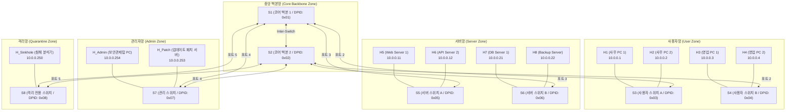

# Phase 6-C: 존(Zone) 기반 대규모 토폴로지 확장 및 물리 관리망 배포 구현 계획서

## 1. 개요 및 목적 (Executive Summary)

본 계획서는 **Phase 6-B-2에서 검증 완료된 4-테이블 동적 마이크로 세그멘테이션 및 자기방어 제어 로직**을 실제 기업/데이터센터급의 **존(Zone) 기반 다중 스위치(8-스위치) 인프라**로 확장 배포하기 위한 기술 명세서입니다.

* **핵심 가치**:
  1. 단순한 단일 다이아몬드 스위치망을 탈피하여, **보안 존(사용자망, 서버망, 관리자망, 격리망)별 전담 엣지 스위치**를 물리/논리적으로 배치.
  2. 중앙 이중화 백본망(Core)을 통한 고속 패킷 포워딩 및 다익스트라(Dijkstra) 다중 경로 최적화.
  3. 관리자망 내에 **실제 격리 치료용 보안 패치/업데이트 서버(`10.0.0.253`) 컨테이너**를 정식 배포.
  4. 기존 282개 단위/통합 테스트의 무결성을 100% 보장하는 **토폴로지 프로파일(듀얼 모드) 아키텍처** 적용.

---

## 2. 존(Zone) 기반 8-스위치 토폴로지 설계



### 2.1 스위치 역할 및 DPID 명세

| DPID | 스위치 이름 | 소속 영역 (Zone) | 역할 | 연결 대상 |
| :--- | :--- | :--- | :--- | :--- |
| `0x01` | `s1` | 중앙 백본 (Core) | 고속 L2/L3 스위칭, 1차 백본 | s2, s3, s5, s7, s8 |
| `0x02` | `s2` | 중앙 백본 (Core) | 백본 이중화, 2차 다중경로 | s1, s4, s6, s7, s8 |
| `0x03` | `s3` | 사용자망 (USER_ZONE) | 일반 사용자 PC(H1, H2) 수용 | s1, H1, H2 |
| `0x04` | `s4` | 사용자망 (USER_ZONE) | 일반 사용자 PC(H3, H4) 수용 | s2, H3, H4 |
| `0x05` | `s5` | 서버망 (SERVER_ZONE) | 웹/애플리케이션 서버 수용 | s1, H5, H6 |
| `0x06` | `s6` | 서버망 (SERVER_ZONE) | 데이터베이스/백업 서버 수용 | s2, H7, H8 |
| `0x07` | `s7` | 관리자망 (ADMIN_ZONE) | 보안관제 단말 및 패치 서버 수용 | s1, s2, H_Admin, H_Patch |
| `0x08` | `s8` | 격리망 (QUARANTINE_ZONE)| 격리 분석 및 가상 싱크홀 수용 | s1, s2, H_Sinkhole |

---

## 3. 호스트 IP/MAC 및 존(Zone) 바인딩 명세

> [!NOTE]
> IP 체계는 현행의 안정성을 유지하기 위해 **`10.0.0.0/24` 플랫 서브넷**을 유지하며, 컨트롤러 정책 테이블(Table 1)의 마이크로 세그멘테이션으로 보안 경계를 완벽히 통제합니다.

| 호스트 | IP 주소 | MAC 주소 | 소속 스위치 | 스위치 포트 | 소속 존 (Zone) | 권한 및 역할 |
| :--- | :--- | :--- | :--- | :--- | :--- | :--- |
| `h1` | `10.0.0.1` | `00:00:00:00:00:01` | `s3` | Port 1 | `USER_ZONE` | 일반 PC (침해 테스트 대상) |
| `h2` | `10.0.0.2` | `00:00:00:00:00:02` | `s3` | Port 2 | `USER_ZONE` | 일반 PC |
| `h3` | `10.0.0.3` | `00:00:00:00:00:03` | `s4` | Port 1 | `USER_ZONE` | 일반 PC |
| `h4` | `10.0.0.4` | `00:00:00:00:00:04` | `s4` | Port 2 | `USER_ZONE` | 일반 PC |
| `h5` | `10.0.0.11` | `00:00:00:00:00:11` | `s5` | Port 1 | `SERVER_ZONE`| Nginx Web Server (HTTP 80) |
| `h6` | `10.0.0.12` | `00:00:00:00:00:12` | `s5` | Port 2 | `SERVER_ZONE`| API Server (TCP 8080) |
| `h7` | `10.0.0.21` | `00:00:00:00:00:21` | `s6` | Port 1 | `SERVER_ZONE`| Database (TCP 3306) |
| `h8` | `10.0.0.22` | `00:00:00:00:00:22` | `s6` | Port 2 | `SERVER_ZONE`| Backup Storage Server |
| `h_patch` | `10.0.0.253` | `00:00:00:00:00:fd` | `s7` | Port 2 | `ADMIN_ZONE` | **보안 업데이트 패치 서버 (물리 컨테이너)** |
| `h_admin` | `10.0.0.254` | `00:00:00:00:00:fe` | `s7` | Port 1 | `ADMIN_ZONE` | 최고 관리자 / 보안관제탑 호스트 |
| `h_sink` | `10.0.0.250` | `00:00:00:00:00:fa` | `s8` | Port 1 | `QUARANTINE_ZONE` | 악성 패킷 분석 싱크홀 |

---

## 4. 컨트롤러 및 핵심 모듈 리팩토링 설계

### 4.1 토폴로지 설정 파일 외부화 (`config/topology_profiles.yaml`)
현재 컨트롤러 소스코드에 하드코딩된 `ACCESS_HOST_PORTS`와 `INTER_SWITCH_PORTS`를 설정 파일로 분리하여 **기존 4-스위치(default)**와 **확장 8-스위치(large)**를 동적으로 로드합니다.

```yaml
profiles:
  diamond_4sw: # 기존 282개 테스트용 프로파일 (Default)
    switches: [1, 2, 3, 4]
    access_hosts:
      1: {1: ["10.0.0.1", "00:00:00:00:00:01"]}
      4: {1: ["10.0.0.2", "00:00:00:00:00:02"]}
    inter_switch: ...

  zone_8sw: # Phase 6-C 대규모 토폴로지 프로파일
    switches: [1, 2, 3, 4, 5, 6, 7, 8]
    access_hosts:
      3:
        1: ["10.0.0.1", "00:00:00:00:00:01"]
        2: ["10.0.0.2", "00:00:00:00:00:02"]
      4:
        1: ["10.0.0.3", "00:00:00:00:00:03"]
        2: ["10.0.0.4", "00:00:00:00:00:04"]
      5:
        1: ["10.0.0.11", "00:00:00:00:00:11"]
        2: ["10.0.0.12", "00:00:00:00:00:12"]
      6:
        1: ["10.0.0.21", "00:00:00:00:00:21"]
        2: ["10.0.0.22", "00:00:00:00:00:22"]
      7:
        1: ["10.0.0.254", "00:00:00:00:00:fe"]
        2: ["10.0.0.253", "00:00:00:00:00:fd"]
      8:
        1: ["10.0.0.250", "00:00:00:00:00:fa"]
    inter_switch:
      # S1 - S2 (Core)
      1: {1: [2, 1], 2: [3, 99], 3: [5, 99], 4: [7, 98], 5: [8, 98]}
      2: {1: [1, 1], 2: [4, 99], 3: [6, 99], 4: [7, 99], 5: [8, 99]}
```

### 4.2 하위 호환성 보장 전략 (Dual-Mode Safety)
* 환경 변수 `SDN_TOPOLOGY_PROFILE`을 도입:
  * 미설정 또는 `diamond_4sw`일 때: 기존 4-스위치 모드로 구동되어 **기존 282개 테스트가 100% 정상 통과**.
  * `zone_8sw`로 설정 시: 확장 8-스위치 토폴로지 그래프로 작동.

---

## 5. 인프라 배포 자동화 스크립트 설계

### 5.1 네이티브 OVS 대규모 배포 스크립트 (`scripts/setup_large_ovs.sh`)
* 8개의 OVS 브리지 생성 (`s1` ~ `s8`, OpenFlow 1.3 활성화).
* 스위치 간 veth 링크 페어 자동 연결 및 MTU 최적화.
* 호스트 네임스페이스(`h1` ~ `h8`, `h_admin`, `h_sink`) 생성 및 IP/MAC 바인딩.
* Docker 기반 **`sdn-patch-server` 컨테이너** 구동 및 `s7` 포트 2번에 veth로 직접 브리징.

### 5.2 정리 스크립트 (`scripts/cleanup_large_ovs.sh`)
* 모든 veth 인터페이스, OVS 브리지, Docker 패치 컨테이너, 네임스페이스의 원클릭 완벽 정리.

### 5.3 보안 업데이트 패치 서버 Dockerfile (`docker/patch_server/Dockerfile`)
* 경량 Alpine Linux + Nginx 기반.
* 보안 패치 파일 다운로드용 HTTP 엔드포인트(`http://10.0.0.253/patches/clean_agent.sh`) 제공.
* 호스트가 격리(QUARANTINE) 상태가 되어도 이 서버의 80번 포트로는 정상 접속 가능함을 검증.

---

## 6. 관제탑 UI(vis-network) 토폴로지 맵 개선

* **존(Zone) 기반 클러스터링/배경 색상 구분**:
  * 백본망 (Core): 회색 계열 그룹
  * 사용자망 (User): 파란색 계열 그룹
  * 서버망 (Server): 녹색 계열 그룹
  * 관리자망 (Admin): 보라색 계열 그룹
  * 격리망 (Quarantine): 주황색/경고 계열 그룹
* **물리적 계층 레이아웃(Hierarchical Layout) 옵션 토글**:
  * 노드가 20개 이상으로 늘어났을 때 노드가 엉키지 않도록 상단(Backbone) -> 하단(Access/Host) 형태의 계층 정렬 지원.

---

## 7. 단계별 상세 실행 마일스톤

| 마일스톤 | 작업 내용 | 예상 소요 | 검증 방법 |
| :--- | :--- | :--- | :--- |
| **M1: 설정 파일 외부화** | `config/topology_profiles.yaml` 생성 및 `controller.py` 프로파일 로더 구현 | 0.5일 | 기존 282개 테스트 100% Pass 확인 |
| **M2: 존(Zone) 확장 명세** | `config/zones.yaml`에 8개 호스트 및 패치/싱크홀 IP 규칙 등록 | 0.5일 | `test_contracts.py` 및 존 검증 단위 테스트 |
| **M3: 인프라 스크립트 구현** | `setup_large_ovs.sh`, `cleanup_large_ovs.sh`, 패치서버 Dockerfile | 1일 | VM 환경에서 8-스위치 링크 연결 및 pingall 확인 |
| **M4: 패치서버 연동 검증** | 격리 상태의 `h1`이 패치서버(`10.0.0.253`)에만 접근 가능한지 L4 E2E 검증 | 0.5일 | E2E 격리/치료 패치 다운로드 시나리오 테스트 |
| **M5: 관제탑 UI 맵 최적화** | `TopologyMap.jsx` 존별 그룹핑 및 20개 이상 노드 레이아웃 튜닝 | 0.5일 | UI 브라우저에서 토폴로지 맵 렌더링 확인 |

---

## 8. 최종 E2E 데모 시나리오 (발표용 완성형)

1. **정상 상태**:
   * 사용자 `h1`이 서버망 `h5`(웹서버)에 HTTP(80) 정상 요청 및 응답 (녹색 링크).
2. **이상 징후 발생 (내부 확산 공격)**:
   * `h1`이 다른 사용자망 PC(`h2~h4`)와 서버망 DB(`h7`)로 악성 무단 스캔/접속 시도.
   * `Table 1` 존 정책 위반(`ZONE_DENY`) 누적 -> AI Criteria 엔진이 `INTERNAL_SPREAD` 즉각 탐지.
3. **자율 자기방어 (동적 격리 발동)**:
   * 컨트롤러가 `h1`의 상태를 `QUARANTINE`으로 전환.
   * `h1`의 모든 외부/내부 통신 차단.
   * **오직 관리자망의 패치서버(`10.0.0.253:80`) 통신만 허용**.
   * 관제탑 대시보드 UI에 `h1` 노드가 주황색 경고(`⚠️ h1 (격리)`)로 실시간 변경.
4. **치료 및 관리자 수동 복귀**:
   * `h1`에서 패치 스크립트 다운로드 및 치료 완료.
   * 보안 관리자가 관제탑 웹 UI에서 `[격리 해제]` 버튼 클릭.
   * `h1`의 플로우가 즉시 원상 복구되어 정상 통신 재개.
