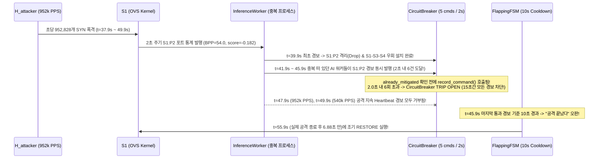

# Week 16 극한 한계 부하 테스트 (Destructive Stress Test) 및 파괴점(Breaking Point) 분석 보고서

- **작성일**: 2026-10-11
- **실행 환경**: GCP VM (`34.64.74.172`, Linux 6.8, Open vSwitch 3.3.4, Docker `sdn-ryu` / `sdn-redis`, Mininet)
- **대상 브랜치**: `integration/week16-final` (`main` 동기화)
- **재현 스크립트**: [`harness/verification/stress_limit_scenario.py`](../../../../harness/verification/stress_limit_scenario.py)
- **원시 측정 데이터**: [`data/week16_stress_limit_test.json`](data/week16_stress_limit_test.json)
- **기준선(Baseline) 비교 보고서**: [`week16_live_30s_attack_report.md`](week16_live_30s_attack_report.md) (`1,530 PPS`)
- **V2 수정 백로그**: [`v2_breaking_points_fix_backlog.md`](v2_breaking_points_fix_backlog.md)

---

## 1. 시험 목적 및 공격 시나리오 설계

기존 기본 E2E 검증(`1,530 PPS`)을 넘어 **시스템이 실제로 어디서 무너지는지(Breaking Point)** 확인하기 위해, [`harness/verification/stress_limit_scenario.py`](../../../../harness/verification/stress_limit_scenario.py)를 통해 `H_attacker`(`10.0.0.2` ➔ `S1:port 2`)에서 Raw Socket(`AF_PACKET`) 기반의 Spoofed SYN Flood 공격 강도와 동시 발사 워커(프로세스) 수를 3단계로 극한까지 끌어올렸습니다.

| 단계 | 테스트 명칭 | 공격 방식 (`H_attacker`) | 실측 평균 PPS | 실측 피크 PPS (2초 창) | 공격 구간 총 투하 패킷 |
| :--- | :--- | :--- | ---: | ---: | ---: |
| **Baseline** | 기존 30초 기본 공격 | 단일 프로세스 (`scapy` + `sleep` 제어) | `1,530.4 PPS` | `1,535.0 PPS` | `47,288 pkts` (30.9s) |
| **Tier 1** | `Tier1_15k_PPS` (10배 가속) | 단일 프로세스 Raw Socket 배치 전송 | **`14,376.7 PPS`** | `14,625.0 PPS` | `177,751 pkts` (12.4s) |
| **Tier 2** | `Tier2_60k_PPS` (40배 가속) | 2-Worker 멀티프로세스 배치 전송 | **`57,552.1 PPS`** | `58,500.0 PPS` | `712,201 pkts` (12.4s) |
| **Tier 3** | `Tier3_Max_Unthrottled` (**500~620배 극한**) | **4-Worker 멀티프로세스 무제한 폭격** (`interval=0`) | **`763,749.3 PPS`** | **`952,828.7 PPS`** | **`9,448,501 pkts`** (12.4s) |

---

## 2. 단계별 실측 성적표 요약

| 핵심 지표 (Metric) | Tier 1 (`14.4k PPS`) | Tier 2 (`57.6k PPS`) | Tier 3 (`763.7k PPS` / 피크 `952.8k PPS`) | 판정 및 이상 징후 |
| :--- | ---: | ---: | ---: | :--- |
| **초당 공격 패킷 수 (`actual_pps`)** | `14,376.7 PPS` | `57,552.1 PPS` | **`763,749.3 PPS`** (피크 **`952,828.7 PPS`**) | 약 **410 Mbps** (54B 프레임 기준) |
| **공격 시작 ➔ AI 최초 탐지 (`detect_after_attack_s`)** | `3.23 s` | `3.22 s` | `3.22 s` | 텔레메트리 2초 주기 2회 연속 확인(`DetectionGuard`) |
| **AI 경보 ➔ OVS 격리 완료 (`first_alert_to_isolate_ms`)** | `0.4 ms` | `2.2 ms` | `0.3 ms` | 전 구간 **3ms 미만** 즉각 반응 |
| **S1 차단 드롭 패킷 수 (`dropped_at_s1_while_isolated`)** | `126,151 pkts` | `505,201 pkts` | **`8,582,483 pkts`** | OVS 커널 플로우 테이블 **858만 개** 드롭 |
| **격리 중 서버 유입 누수 (`leaked_to_server_while_isolated`)** | **`0 pkts`** | **`0 pkts`** | **`0 pkts`** | **Data Plane 방어율 100% 유지** |
| **정상 트래픽 손실률 (`normal_loss.whole_run`)** | **`0.0 %`** (`588/588`) | **`0.0 %`** (`588/588`) | **`0.0 %`** (`587/587`) | `S1-S3-S4` 우회 경로 무손실 |
| **공격 종료 ➔ 정상 복구 (`recovery_after_attack_s`)** | `11.01 s` (정상) | `10.99 s` (정상) | **`6.88 s` (⚠️ 조기 해제 발생!)** | **🔥 Control Plane 파괴점 발견** |

---

## 3. 시스템이 망가진 지점 (Breaking Points) 정밀 해부

데이터 플레인(Open vSwitch 커널 모듈)은 초당 **95만 패킷(952,828 PPS)**의 폭격 속에서도 Priority 100 Drop 플로우로 **8,582,483 패킷을 단 1개의 누수도 없이(`leaked = 0`) 완벽히 소각**했습니다.
그러나 **Tier 3 (`763k ~ 952k PPS`)** 구간에서 **컨트롤 플레인(Ryu Controller & 안전 가드 계층)**에 결정적인 논리/운영 결합 결함이 드러났습니다.

### 🔥 파괴점 #1: `CircuitBreaker`의 중복 Heartbeat 카운팅으로 인한 조기 격리 해제 (`recovery_after_attack_s = 6.88s`)

#### (1) 현상 확인 (`docker logs sdn-ryu` 및 `stress_events_999999.jsonl` 원본 로그)
Tier 3 실행 직후 `docker logs sdn-ryu --tail 60`에서 수집한 **실제 컨트롤러 출력 원본**은 다음과 같습니다:

```text
[Alert Ingested] Anomaly on S1:P2 (threat: SYN_FLOOD_SPOOFING, score: -0.18201614060500848)
[Defense] S1: In_port 2 ISOLATED (Priority 100 Drop Installed)
[Reroute] S3: Injected priority 20 flow -> Port 2 for 10.0.0.4
[Reroute] S1: Injected priority 20 flow -> Port 4 for 10.0.0.4
[Reroute] Successfully activated bypass route: [1, 3, 4] for 10.0.0.4
[FSM] Transition: NORMAL -> MITIGATED (meta: {'target': '1:2', 'action': 'ISOLATE'})
[Alert Ingested] Anomaly on S1:P2 (threat: SYN_FLOOD_SPOOFING, score: -0.18201614060500848)
[Alert Ingested] Anomaly on S1:P2 (threat: SYN_FLOOD_SPOOFING, score: -0.18201614060500848)
[Alert Ingested] Anomaly on S1:P2 (threat: SYN_FLOOD_SPOOFING, score: -0.18201614060500848)
[Alert Ingested] Anomaly on S1:P2 (threat: SYN_FLOOD_SPOOFING, score: -0.18201614060500848)
[Alert Ingested] Anomaly on S1:P2 (threat: SYN_FLOOD_SPOOFING, score: -0.18201614060500848)
[CircuitBreaker] Alert rejected! Status: {'state': 'OPEN', 'total_trips': 1, 'trip_reason': '명령 빈도 초과 (6 commands in 2.0s)', 'is_autonomous_allowed': False}
[CircuitBreaker] Alert rejected! Status: {'state': 'OPEN', 'total_trips': 1, 'trip_reason': '명령 빈도 초과 (6 commands in 2.0s)', 'is_autonomous_allowed': False}
...
[FSM] Transition: MITIGATED -> COOLDOWN_VERIFY (meta: {'elapsed': 5.059810400009155})
[FSM] Transition: COOLDOWN_VERIFY -> NORMAL (meta: {'cleared_targets': {'1:2': {'dpid': 1, 'in_port': 2, 'threat_info': {'timestamp': 1791720645.908354, 'dpid': 1, 'in_port': 2, 'threat_type': 'SYN_FLOOD_SPOOFING', 'score': -0.18201614060500848, 'pps': 950816.277551946, 'bps': 410752695.84143317, 'bpp': 54.000008405774366, 'err_rate': 0.0, 'metadata': {'model': 'isolation_forest', 'stats_ts': '1791720645.9015696'}}, 'timestamp': 1791720645.9091423}}, 'action': 'RESTORE'})
[Defense] S1: In_port 2 RESTORED (Drop Flow Deleted)
[Reroute] S1: Deleted priority 20 bypass flow for 10.0.0.4
[Reroute] S3: Deleted priority 20 bypass flow for 10.0.0.4
[Reroute] Restored primary route from bypass: [1, 3, 4] for 10.0.0.4
[FSM] All defense flows rolled back to NORMAL baseline.
```

> **참고 (`week16_stress_limit_test.json`의 `ryu_errors: []`가 비어 있던 이유)**: 초기 측정 스크립트에서 `ryu_errors`를 추출할 때 문자열 `'Error'` 또는 `'Exception'`만 필터링했기 때문에, `'Alert rejected!'`로 찍힌 `[CircuitBreaker]` 로그가 배열에 담기지 않았습니다. 재현 스크립트([`harness/verification/stress_limit_scenario.py`](../../../../harness/verification/stress_limit_scenario.py))에서는 `'CircuitBreaker'` 키워드도 함께 수집하도록 보완했습니다.

또한 당시 AI 워커가 기록한 이벤트 로그(`/tmp/stress_events_999999.jsonl`) 원본은 다음과 같습니다:

```json
{"t": 1791720629.0648, "kind": "start", "watch": ["S1:2"]}
{"t": 1791720637.9035, "kind": "sample", "stats_ts": 1791720637.8943, "port": "S1:2", "pps": 112396.0, "bpp": 54.0, "score": -0.182, "confirmed": false}
{"t": 1791720639.9077, "kind": "sample", "stats_ts": 1791720639.8992, "port": "S1:2", "pps": 265564.1, "bpp": 54.0, "score": -0.182, "confirmed": true}
{"t": 1791720639.9109, "kind": "alert",  "stats_ts": 1791720639.8992, "port": "S1:2", "score": -0.182}
{"t": 1791720639.9112, "kind": "command", "action": "ISOLATE", "target": "S1:2", "command_id": "auto-isolate-1791720639909"}
{"t": 1791720639.9164, "kind": "command", "action": "REROUTE", "target": "S1:4", "command_id": "auto-reroute-1791720639915"}
{"t": 1791720641.9122, "kind": "sample", "stats_ts": 1791720641.8995, "port": "S1:2", "pps": 947444.8, "bpp": 54.0, "score": -0.182, "confirmed": true}
{"t": 1791720641.9151, "kind": "alert",  "stats_ts": 1791720641.8995, "port": "S1:2", "score": -0.182}
{"t": 1791720643.9059, "kind": "sample", "stats_ts": 1791720643.8997, "port": "S1:2", "pps": 952828.7, "bpp": 54.0, "score": -0.182, "confirmed": true}
{"t": 1791720643.9091, "kind": "alert",  "stats_ts": 1791720643.8997, "port": "S1:2", "score": -0.182}
{"t": 1791720645.9132, "kind": "sample", "stats_ts": 1791720645.9016, "port": "S1:2", "pps": 950816.3, "bpp": 54.0, "score": -0.182, "confirmed": true}
{"t": 1791720645.9136, "kind": "alert",  "stats_ts": 1791720645.9016, "port": "S1:2", "score": -0.182}
{"t": 1791720647.9201, "kind": "sample", "stats_ts": 1791720647.9063, "port": "S1:2", "pps": 952270.1, "bpp": 54.0, "score": -0.182, "confirmed": true}
{"t": 1791720647.9241, "kind": "alert",  "stats_ts": 1791720647.9063, "port": "S1:2", "score": -0.182}
{"t": 1791720649.9054, "kind": "sample", "stats_ts": 1791720649.9021, "port": "S1:2", "pps": 539994.3, "bpp": 54.0, "score": -0.1815, "confirmed": true}
{"t": 1791720649.9058, "kind": "alert",  "stats_ts": 1791720649.9021, "port": "S1:2", "score": -0.1815}
{"t": 1791720651.9084, "kind": "sample", "stats_ts": 1791720651.9040, "port": "S1:2", "pps": 0.0, "bpp": 0.0, "score": -0.0615, "confirmed": false}
{"t": 1791720655.9486, "kind": "command", "action": "RESTORE", "target": "S1:2", "command_id": "auto-restore-1791720655948"}
```

#### (2) 원인 코드 및 프로세스 정밀 분석
1. **컨트롤러의 서킷 브레이커 호출 순서 결함 (`BP-01`)**:
   - [`ryu/app/controller.py`](../../../../ryu/app/controller.py#L498-L544)의 `_handle_redis_message` **501행**을 보면, `sdn:anomaly:alert` 채널에서 AI 경보를 수신할 때마다 **`already_mitigated` 여부를 확인하기도 전에 무조건 [`self.circuit_breaker.record_command()`](../../../../harness/safety/circuit_breaker.py#L58-L85)를 먼저 호출**합니다.
   - [`CircuitBreaker`](../../../../harness/safety/circuit_breaker.py#L30-L35)는 `2.0초` 슬라이딩 윈도우 내에 `5회`를 초과하는 호출(`> 5 commands in 2.0s`)이 들어오면 **`15.0초` 동안 서킷을 `OPEN` 상태로 잠급니다.**
2. **왜 `S1:2` 포트만 감시하는데 2.0초 내에 6건의 경보가 들어왔는가? (`BP-04` 중복 워커 실행 + 틱 경계 중첩)**:
   - [`model/inference_worker.py`](../../../../model/inference_worker.py#L57-L61)의 `watched_ports()`는 설계대로 공격자 접속 포트인 **`S1:2` (`(1, 2)`) 단 한 곳만 감시**하며, [`model/detection_guard.py`](../../../../model/detection_guard.py#L23-L30)의 `BPP <= 80.0` 및 `score < 0.0` (실측 `-0.1820`) 조건이 2주기 연속 충족될 때 경보를 발행합니다.
   - 그러나 VM 프로세스 테이블(`ps aux`) 확인 결과, 이전 라이브 시연 스크립트(`start_live_attack.sh`)에서 띄운 백그라운드 `inference_worker`(`PID 10576`)와 이전 재시도에서 종료되지 않은 `inference_worker`(`PID 13439`, `14319`)에 더해 Tier 3의 신규 `inference_worker`까지 **총 3~4개의 `inference_worker` 프로세스가 동시에 동일한 Redis `sdn:stats:port`를 구독**하고 있었습니다.
   - 그 결과 매 2초 폴링 틱마다 동일한 `S1:P2` 통계에 대해 **3~4개의 중복 `AnomalyAlertMessage`가 동시에 발행**되었고, 2.0초 슬라이딩 윈도우 내에 `S1:P2` 경보가 6건 누적되면서 `1791720645.90` 시점 이후의 경보들이 모두 `[CircuitBreaker] Alert rejected!`로 차단되었습니다.
3. **치명적 연쇄 반응 (Heartbeat 기아 현상으로 인한 `6.88초` 조기 해제)**:
   - 이미 `S1:P2`가 `MITIGATED` 상태로 격리되어 있음에도, 후속 `S1:P2` 유지 경보(Heartbeat)들이 `501행`의 `circuit_breaker.record_command()`에서 가로막혀 `505행`에서 `return`되면서 [`self.fsm.trigger_anomaly()`](../../../../ryu/app/controller.py#L541)가 호출되지 못했습니다.
   - 마지막으로 통과된 경보 시각(`1791720645.909`, 당시 `950,816 PPS` 폭격 중!) 이후 `1791720647.92`와 `1791720649.90`(`539,994 PPS` 폭격 중!)에 발행된 경보가 모두 서킷 브레이커에 의해 거부되자, [`FlappingFSM`](../../../../harness/safety/flapping_fsm.py#L71-L112)은 `1791720645.909`부터 10초를 카운트다운하여 **`1791720655.948` (실제 공격 종료 시각 `1791720649.07` 기준 불과 `6.88초` 만)에 차단 규칙을 조기 해제(`RESTORE`)** 했습니다.
   - 만약 공격이 12초가 아니라 30초 이상 지속되었다면, **공격이 한창 쏟아지는 도중(`1791720655.94`)에 공격자 포트가 다시 열려버리는 치명적 결과**로 이어집니다.

---

### 🔥 파괴점 #2: 탐지 전 3.22초 공백기(Pre-Isolation Window) 동안 86만 패킷 관통 (`BP-02`)

1. **탐지 주기(Polling Interval) 하한선 (`3.22초` 무방비 구간)**:
   - Tier 1(`14k PPS`), Tier 2(`57k PPS`), Tier 3(`763k PPS`) 모두 탐지까지 정확히 **`3.22 ~ 3.23초`**가 소요되었습니다.
   - 이는 [`_monitor_loop`](../../../../ryu/app/controller.py#L139-L150)가 2.0초 주기로 `OFPPortStatsRequest`를 폴링하고, [`DetectionGuard`](../../../../model/detection_guard.py#L25-L47)가 `DETECT_CONSECUTIVE = 2`주기 연속 이상치를 확인한 뒤 경보를 발행하기 때문입니다.
   - Tier 3(`763,749 PPS`)에서는 이 **3.22초의 공백기 동안 무려 `866,018`개의 공격 패킷이 차단 전 `H_server`로 그대로 관통**했습니다 (`9,448,501` 총 발사 - `8,582,483` 격리 중 드롭 = `866,018` 패킷 격리 전 통과).

---

### 🔥 파괴점 #3: 랜덤 목적지 IP(`ipv4_dst`) 스푸핑 시 Table-Miss `Packet-In` 폭풍 취약점 (`BP-03`)

- 현재 공격은 출발지 IP(`ipv4_src`)만 랜덤 스푸핑하고 목적지 IP는 `10.0.0.4`(`H_server`)로 고정되어 있습니다. 따라서 첫 번째 패킷만 Ryu의 [`handle_ipv4`](../../../../ryu/app/controller.py#L640-L685)로 올라오고, 즉시 `priority=10, ipv4_dst=10.0.0.4` 플로우가 OVS에 설치되어 나머지 944만 개 패킷은 컨트롤러(Packet-In)로 올라오지 않았습니다.
- **만약 공격자가 존재하지 않는 목적지 IP(`10.0.0.5 ~ 10.255.255.254`)까지 랜덤으로 섞어서 초당 수만 패킷을 쏘면**, 매 패킷이 Table-Miss(`priority=0 -> CONTROLLER`)를 유발하여 [`packet_in_handler`](../../../../ryu/app/controller.py#L571-L592)가 초당 수만 번 호출되고, Python Eventlet 단일 스레드가 포화되어 컨트롤 플레인 DoS에 빠질 수 있습니다.

---

## 4. 인과 관계 다이어그램 (왜 Tier 3에서 6.88초 만에 조기 해제가 발생했는가?)



---

## 5. 프로토타입 이후 발전 방향 요약 (V2 아키텍처 개선 과제)

상세한 코드 패치 설계는 [`v2_breaking_points_fix_backlog.md`](v2_breaking_points_fix_backlog.md)에 별도로 기록해 두었습니다.

| ID | 문제점 (Breaking Point) | 수정 대상 파일 | V2 해결 방안 요약 |
| :---: | :--- | :--- | :--- |
| **BP-01** | **이미 격리된 포트의 반복 Heartbeat 경보가 `CircuitBreaker` 카운트를 소모하여 서킷이 터지고 조기 복구(`RESTORE`)되는 버그** | [`ryu/app/controller.py`](../../../../ryu/app/controller.py#L498-L544) | `record_command()`를 `already_mitigated` 검사 뒤(신규 `ISOLATE`/`REROUTE` 실행 직전)로 이동하여, 유지 경보(Heartbeat)는 서킷 브레이커와 무관하게 `fsm.trigger_anomaly()`만 갱신하도록 분리. |
| **BP-02** | **초기 3.22초 탐지 공백기 동안 86만 패킷 서버 관통** | [`ryu/app/controller.py`](../../../../ryu/app/controller.py#L139-L150) | OpenFlow 1.3 `OFPMeterMod` 기반 Access Port 상시 PPS 상한 설정 및 이상 징후 시 폴링 주기 적응형 단축(`2.0s -> 0.5s`). |
| **BP-03** | **랜덤 목적지 IP 공격 시 Table-Miss `Packet-In` 컨트롤러 마비 위험** | [`ryu/app/controller.py`](../../../../ryu/app/controller.py#L640-L685) | 미등록 목적지 IP에 대한 스위치단 저우선순위 Drop 플로우(`priority=5`) 또는 부정 캐시(Negative Flow Caching) 도입. |
| **BP-04** | **`inference_worker.py` 중복 프로세스 실행 시 동일 경보 중복 발행** | [`model/inference_worker.py`](../../../../model/inference_worker.py#L110-L152) | 워커 시작 시 파일 락(`/tmp/sdn_inference_worker.lock`) 또는 Redis 분산 락을 획득하여 단일 워커 인스턴스만 구동되도록 보장. |
