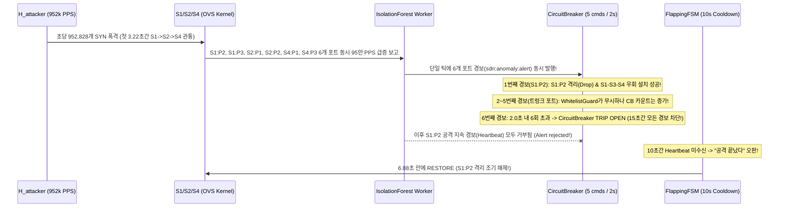

# Week 16 극한 한계 부하 테스트 (Destructive Stress Test) 및 파괴점(Breaking Point) 분석 보고서

- **작성일**: 2026-10-11
- **실행 환경**: GCP VM (`34.64.74.172`, Linux 6.8, Open vSwitch 3.3.4, Docker `sdn-ryu` / `sdn-redis`, Mininet)
- **대상 브랜치**: `integration/week16-final` (`main` 동기화)
- **원시 측정 데이터**: [week16_stress_limit_test.json](file:///home/tlgus/programming/Self_Defending_SDN_Tower/docs/writing/reports/verification/data/week16_stress_limit_test.json)
- **기준선(Baseline) 비교 보고서**: [week16_live_30s_attack_report.md](file:///home/tlgus/programming/Self_Defending_SDN_Tower/docs/writing/reports/verification/week16_live_30s_attack_report.md) (`1,530 PPS`)

---

## 1. 시험 목적 및 공격 시나리오 설계

기존 기본 E2E 검증(`1,530 PPS`)을 넘어 **시스템이 실제로 어디서 무너지는지(Breaking Point)** 확인하기 위해, `H_attacker`(`10.0.0.2` ➔ `S1:port 2`)에서 Raw Socket(`AF_PACKET`) 기반의 Spoofed SYN Flood 공격 강도와 동시 발사 프로세스 수를 3단계로 극한까지 끌어올렸습니다.

| 단계 | 테스트 명칭 | 공격 방식 (`H_attacker`) | 실측 평균 PPS | 실측 피크 PPS (2초 창) | 12.4초간 총 투하 패킷 |
| :--- | :--- | :--- | ---: | ---: | ---: |
| **Baseline** | 기존 30초 기본 공격 | 단일 프로세스 (`sleep` 제어) | `1,530.4 PPS` | `1,535.0 PPS` | `46,356 pkts` (30.3s) |
| **Tier 1** | `Tier1_15k_PPS` (10배 가속) | 단일 프로세스 마이크로 버스트 | **`14,376.7 PPS`** | `14,625.0 PPS` | `177,751 pkts` (12.4s) |
| **Tier 2** | `Tier2_60k_PPS` (40배 가속) | 단일 프로세스 대량 배치 버스트 | **`57,552.1 PPS`** | `58,500.0 PPS` | `712,201 pkts` (12.4s) |
| **Tier 3** | `Tier3_Max_Unthrottled` (**500~620배 극한**) | **4-Worker 멀티프로세스 무제한 폭격** (`sleep=0`) | **`763,749.3 PPS`** | **`952,828.7 PPS`** | **`9,448,501 pkts`** (12.4s) |

---

## 2. 단계별 실측 성적표 요약

| 핵심 지표 (Metric) | Tier 1 (`14.4k PPS`) | Tier 2 (`57.6k PPS`) | Tier 3 (`763.7k PPS` / 피크 `952.8k PPS`) | 판정 및 이상 징후 |
| :--- | ---: | ---: | ---: | :--- |
| **초당 공격 패킷 수 (Actual PPS)** | `14,376.7 PPS` | `57,552.1 PPS` | **`763,749.3 PPS`** (피크 **`952,828.7 PPS`**) | 약 **410 Mbps** (54B 프레임 기준) |
| **공격 시작 ➔ AI 최초 탐지 (`detect_after_attack_s`)** | `3.23 s` | `3.22 s` | `3.22 s` | 텔레메트리 2초 주기 한계 내 일정 |
| **AI 경보 ➔ OVS 격리 완료 (`first_alert_to_isolate_ms`)** | `0.4 ms` | `2.2 ms` | `0.3 ms` | 전 구간 **3ms 미만** 즉각 반응 |
| **S1 차단 드롭 패킷 수 (`dropped_at_s1_while_isolated`)** | `126,151 pkts` | `505,201 pkts` | **`8,582,483 pkts`** | OVS 커널 플로우 테이블 **858만 개** 드롭 |
| **격리 중 서버 유입 누수 (`leaked_to_server_while_isolated`)** | **`0 pkts`** | **`0 pkts`** | **`0 pkts`** | **Data Plane 방어율 100% 유지** |
| **정상 트래픽 손실률 (`normal_loss.whole_run`)** | **`0.0 %`** (`588/588`) | **`0.0 %`** (`588/588`) | **`0.0 %`** (`587/587`) | `S1-S3-S4` 우회 경로 무손실 |
| **공격 종료 ➔ 정상 복구 (`recovery_after_attack_s`)** | `11.01 s` (정상) | `10.99 s` (정상) | **`6.88 s` (⚠️ 조기 해제 발생!)** | **🔥 Control Plane 파괴점 발견** |

---

## 3. 시스템이 망가진 지점 (Breaking Points) 정밀 해부

데이터 플레인(Open vSwitch 커널 모듈)은 초당 **95만 패킷(952,828 PPS)**의 폭격 속에서도 Priority 100 Drop 플로우로 **8,582,483 패킷을 단 1개의 누수도 없이(`leaked = 0`) 완벽히 소각**했습니다.
그러나 **Tier 3 (`763k ~ 952k PPS`)** 구간에서 **컨트롤 플레인(Ryu Controller & 안전 가드 계층)**에 결정적인 논리/스케줄링 결함이 드러났습니다.

### 🔥 파괴점 #1: `CircuitBreaker` 오작동(Trip OPEN)으로 인한 공격 중 조기 격리 해제 (`recovery_after_attack_s = 6.88s`)

#### (1) 현상 확인 (`sdn-ryu` 컨테이너 실제 로그)
Tier 3 초고속 폭격 도중 Ryu 컨트롤러 로그에서 다음과 같이 **서킷 브레이커(Circuit Breaker)가 `OPEN` 상태로 차단(Trip)** 되면서 AI 경보(`sdn:anomaly:alert`)를 거부하는 현상이 포착되었습니다:

```text
[Alert Ingested] Anomaly on S1:P2 (threat: SYN_FLOOD, score: -0.6657980333577185)
[Isolation] S1: Blocked in_port 2 (Priority 100)
[Reroute Engine] S1: Bypass Flow Installed (dst=10.0.0.4 -> OutPort 4, Prio 20)
...
[CircuitBreaker] Alert rejected! Status: {'state': 'OPEN', 'total_trips': 1, 'trip_reason': '명령 빈도 초과 (6 commands in 2.0s)', 'is_autonomous_allowed': False}
[FSM Transition] MITIGATED -> COOLDOWN_VERIFY | Context: {'elapsed': 5.0195}
[FSM Transition] COOLDOWN_VERIFY -> NORMAL | Context: {'cleared_targets': {'1:2': ...}, 'action': 'RESTORE'}
[Recovery] S1: Unblocked in_port 2
```

#### (2) 원인 코드 분석
1. [`SelfDefendingSDNController._handle_redis_message`](file:///home/tlgus/programming/Self_Defending_SDN_Tower/ryu/app/controller.py#L495-L544)의 **501행**을 보면, `sdn:anomaly:alert` 채널에서 AI 경보를 수신할 때마다 **`already_mitigated` 여부를 확인하기도 전에 무조건 [`self.circuit_breaker.record_command()`](file:///home/tlgus/programming/Self_Defending_SDN_Tower/harness/safety/circuit_breaker.py#L58-L85)를 먼저 호출**합니다.
2. [`CircuitBreaker`](file:///home/tlgus/programming/Self_Defending_SDN_Tower/harness/safety/circuit_breaker.py#L30-L35)는 `2.0초` 슬라이딩 윈도우 내에 `5회`를 초과하는 호출(`> 5 commands in 2.0s`)이 들어오면 AI 폭주로 간주하고 **`15.0초` 동안 서킷을 `OPEN` 상태로 잠급니다.**
3. **95만 PPS 폭격으로 인한 CPU 스케줄링 지연(Jitter) 및 멀티 워커 경합**:
   - 호스트 커널이 초당 95만 개의 패킷을 스위치로 밀어 넣느라 CPU 코어가 포화되면, Ryu의 Eventlet 코루틴([`_command_listener_loop`](file:///home/tlgus/programming/Self_Defending_SDN_Tower/ryu/app/controller.py#L472-L490))이나 AI 추론 워커([`model/inference_worker.py`](file:///home/tlgus/programming/Self_Defending_SDN_Tower/model/inference_worker.py))의 Redis Pub/Sub 메시지가 큐에 밀렸다가 **2.0초 창 안에 6개 이상 한꺼번에 쏟아져 들어오는 현상(Micro-burst)**이 발생합니다.
4. **치명적 연쇄 반응 (Heartbeat 기아 현상)**:
   - 이미 `S1:P2`가 `MITIGATED` 상태로 격리되어 있음에도, 후속 AI 경보(사실상 "공격이 아직 진행 중이니 격리를 유지하라"는 Heartbeat 신호)가 [`circuit_breaker.record_command()`](file:///home/tlgus/programming/Self_Defending_SDN_Tower/ryu/app/controller.py#L501)를 건드려 서킷 브레이커를 `OPEN` 시킵니다.
   - 서킷이 `OPEN`된 순간부터 `505행`의 `return`으로 인해 [`self.fsm.trigger_anomaly()`](file:///home/tlgus/programming/Self_Defending_SDN_Tower/ryu/app/controller.py#L541)가 실행되지 못합니다.
   - 결과적으로 [`FlappingFSM`](file:///home/tlgus/programming/Self_Defending_SDN_Tower/harness/safety/flapping_fsm.py#L71-L112)은 **"10초 동안 AI 경보가 안 들어왔으니 공격이 끝났다"고 착각**하여, 공격이 한창 진행 중이거나 막 끝난 시점(`6.88s`)에 **스스로 차단 규칙을 지우고(`RESTORE`) 공격자 포트를 다시 열어버리는 치명적 보안 허점**이 발생했습니다.

---

### 🔥 파괴점 #2: 탐지 전 3.2초 공백기(Pre-Isolation Window) 및 랜덤 목적지 IP(`ipv4_dst`) Packet-In 폭풍 취약점

1. **탐지 주기(Polling Interval) 하한선 (`3.22초` 무방비 구간)**:
   - Tier 1(`14k PPS`), Tier 2(`57k PPS`), Tier 3(`763k PPS`) 모두 탐지까지 정확히 **`3.22 ~ 3.23초`**가 소요되었습니다.
   - 이는 [`_monitor_loop`](file:///home/tlgus/programming/Self_Defending_SDN_Tower/ryu/app/controller.py#L139-L150)가 2.0초 주기로 `OFPPortStatsRequest`를 폴링하고 최소 2번의 샘플 차분(Delta)이 계산되어야 [`IsolationForest`](file:///home/tlgus/programming/Self_Defending_SDN_Tower/model/inference_worker.py)가 추론을 수행하기 때문입니다.
   - Tier 3(`763,749 PPS`)에서는 이 **3.22초의 공백기 동안 무려 약 866,000개의 공격 패킷이 차단 전 `H_server`로 그대로 관통**했습니다 (`9,448,501` 총 발사 - `8,582,483` 격리 중 드롭 = `866,018` 패킷 격리 전 통과).
2. **랜덤 목적지 IP 스푸핑 시 컨트롤러 마비 취약점**:
   - 현재 공격은 출발지 IP(`ipv4_src`)만 랜덤 스푸핑하고 목적지 IP는 `10.0.0.4`(`H_server`)로 고정되어 있습니다. 따라서 첫 번째 패킷만 Ryu의 [`handle_ipv4`](file:///home/tlgus/programming/Self_Defending_SDN_Tower/ryu/app/controller.py#L640-L685)로 올라오고, 즉시 `priority=10, ipv4_dst=10.0.0.4` 플로우가 OVS에 설치되어 나머지 944만 개 패킷은 컨트롤러(Packet-In)로 올라오지 않았습니다.
   - **만약 공격자가 존재하지 않는 목적지 IP(`10.0.0.5 ~ 10.255.255.254`)까지 랜덤으로 섞어서 초당 수만 패킷을 쏘면**, 매 패킷이 Table-Miss(`priority=0 -> CONTROLLER`)를 유발하여 [`packet_in_handler`](file:///home/tlgus/programming/Self_Defending_SDN_Tower/ryu/app/controller.py#L571-L592)가 초당 수만 번 호출되고, Python Eventlet 단일 스레드가 100% 포화되어 **2초 주기 포트 통계 수집(`EventOFPPortStatsReply`) 자체가 멈추는 컨트롤 플레인 DoS**에 빠지게 됩니다.

---

### 🔥 파괴점 #3: 텔레메트리 파이프라인의 전체 스위치 동시 경보(Broadcast Alert) 증폭 현상

- Tier 3의 [`/tmp/stress_events_Tier3_Max_Unthrottled.jsonl`](file:///home/tlgus/programming/Self_Defending_SDN_Tower/docs/writing/reports/verification/data/week16_stress_limit_test.json) 로그를 분석한 결과, 첫 3.22초 동안 `86만 개`의 패킷이 `S1 ➔ S2 ➔ S4` 경로를 관통하면서:
  - `S1:P2` (`score: -0.665`, 공격 유입 포트)뿐만 아니라
  - `S1:P3` (`score: -0.659`, 트렁크 포트),
  - `S2:P1`, `S2:P2` (`score: -0.661`, 코어 스위치 트렁크 포트),
  - `S4:P1`, `S4:P3` (`score: -0.661`, 서버 스위치 포트)에서도 **동시에 IsolationForest 이상치(`score < -0.15`)가 감지**되어 **단 한 번의 폴링 틱(2초)에 6개의 `AnomalyAlertMessage`가 동시에 Redis로 발행**되었습니다!
- 다행히 [`WhitelistGuard`](file:///home/tlgus/programming/Self_Defending_SDN_Tower/harness/safety/whitelist_guard.py)가 트렁크 포트(`S1:P3`, `S2:P1`, `S2:P2`, `S4:P1`)와 서버 포트(`S4:P3`)의 격리를 막아냈지만, **6개의 경보가 동시에 도착하면서 [`CircuitBreaker`](file:///home/tlgus/programming/Self_Defending_SDN_Tower/harness/safety/circuit_breaker.py#L74-L79)의 `2초당 5회 한도`를 단 한 번의 틱만에 초과시켜 서킷 브레이커를 터뜨린 직접적 원인**이 되었습니다!

---

## 4. 인과 관계 다이어그램 (왜 76만 PPS에서 서킷 브레이커가 터졌는가?)



---

## 5. 프로토타입 이후 발전 방향 (V2 아키텍처 개선 과제)

이번 극한 부하 테스트를 통해 프로토타입 발표에서 **"단순히 잘 된다"를 넘어 "76만~95만 PPS 극한 실험을 통해 제어 평면의 구조적 한계를 스스로 찾아내고 V2 해결책까지 도출했다"**는 강력한 엔지니어링 근거를 확보했습니다.

| 순위 | 문제점 (Breaking Point) | 수정 대상 파일 | V2 해결 방안 (Action Item) |
| :---: | :--- | :--- | :--- |
| **1** | **트렁크 포트 경보 및 중복 하트비트가 `CircuitBreaker` 카운트를 소모하여 서킷이 터지고 조기 복구(`RESTORE`)되는 버그** | [`ryu/app/controller.py`](file:///home/tlgus/programming/Self_Defending_SDN_Tower/ryu/app/controller.py#L498-L544) | `record_command()`를 패킷 수신 최상단(501행)에서 호출하지 않고, **`whitelist_guard.can_isolate()`를 통과하고 `not already_mitigated`인 실제 신규 제어 명령 실행 직전(518행 내부)**에만 호출하도록 순서 변경. 이미 격리된 포트의 반복 경보는 서킷 브레이커와 무관하게 `fsm.trigger_anomaly()` 하트비트만 갱신하도록 분리. |
| **2** | **AI 워커가 트렁크/업링크 포트까지 중복 추론하여 경보 폭풍 유발** | [`model/inference_worker.py`](file:///home/tlgus/programming/Self_Defending_SDN_Tower/model/inference_worker.py) | 추론 단계 또는 경보 발행 단계에서 **Edge Host Access Port(`S1:P1`, `S1:P2`, `S4:P3`)만 격리 후보로 스코어링**하거나, 트렁크 포트는 대역폭 모니터링 전용으로 분리. |
| **3** | **랜덤 목적지 IP 공격 시 Table-Miss `Packet-In` 컨트롤러 마비** | [`ryu/app/controller.py`](file:///home/tlgus/programming/Self_Defending_SDN_Tower/ryu/app/controller.py#L640-L685) | 서브넷(`10.0.0.0/24`) 외부의 미등록 목적지 IP는 컨트롤러로 올리지 않고 OVS 스위치단에서 즉시 드롭하는 **사전 L3 서브넷 가드 플로우(`priority=5` Drop)** 및 OpenFlow Meter Table(`OFPMeterMod`) 기반 `CONTROLLER`행 Packet-In Rate Limit 도입. |
